

## 초록

*작성 예정 — 분석 후 실제 결과를 바탕으로 작성*

**주제어:** GPM-IMERG, ASOS, 일강수량, 지점별 편차, 강수 규모

## 1. 연구 배경 {#background}

### 1.1 여름철 강수정보의 중요성과 위성기반 강수자료의 활용 가치

우리나라의 여름철(6-8월)은 장마와 태풍의 영향으로 연 강수량의 과반이 집중되는 시기이며, 기후변화로 인해 시공간적 예측이 어려운 국지성 집중호우가 빈발하고 있다. 더하여, 본 연구의 대상지인 부산, 울산, 창원을 아우르는 동남권은 복잡한 해안 지형과 고밀도 도심이 결합되어 있어, 짧은 시간의 집중 호우만으로도 도심지 지하차도 침수, 하천 범람, 산사태 등 치명적인 대형 재난으로 직결될 위험이 크다.
이러한 국지성 집중호우와 반대되는 극한 가뭄 상황에서도 강수량 모니터링은 필수적이다. 우리나라는 6-9월에 강수가 집중되고 대부분이 바다로 빠르게 유출되어 수자원 유지 관리가 지형적으로 불리하다.[[9]](#ref-9) 강수 부족이 저수 부족으로 이어져 농작물 피해나 강수량 변동에 직접적인 영향을 받는 수력발전[[12]](#ref-12) 등 에너지 분야에 이르기까지 강수는 그 자체로 다양한 분야와 얽혀있다. 구체적인 사례는 다음과 같다.

*표 1.1.1. 여름철 주요 강수 재해 및 가뭄 사례*

| 구분 | 발생 시기 및 지역 | 주요 피해 및 현황 | 출처 |
| :--- | :--- | :--- | :---: |
| **집중호우** (도시침수) | 2020년 7월 부산 | 시간당 80 mm 이상 집중호우와 만조가 겹쳐 초량 제1지하차도 침수(사망 3명) 및 수백 건 침수 피해 발생 | <a href="#ref-1">[1]</a><a href="#ref-2">[2]</a> |
| **집중호우** (댐 방류) | 2020년 8월 경남 합천·남강댐 | 계획홍수위 도달에 따른 대량 방류로 주택·농경지 침수 및 가축 폐사 등 약 3,700억 원 규모 경제적 손실 발생 | <a href="#ref-3">[3]</a><a href="#ref-4">[4]</a> <a href="#ref-5">[5]</a><a href="#ref-6">[6]</a> |
| **극한 호우** | 2024년 9월 부산·창원 | 일 누적 수백 mm에 달하는 극한 강수로 대규모 주민 대피 및 도심 침수 사태 발생 | <a href="#ref-7">[7]</a><a href="#ref-8">[8]</a> |
| **극심한 가뭄** | 2026년 여름 경남 전역 | 평년 대비 절반 이하 저수율(33.3%) 기록 및 1,900 ha 이상 농작물 가뭄 피해 발생 | <a href="#ref-10">[10]</a> |

즉 여러 재해를 방지하고 발생할 수 있는 사회적, 경제적, 기술적 문제를 막기 위해 **정확한 강우정보 파악은 필요하다**. 

강우정보 산정시 활용할 위성 자료의 특성을 기상청에서 주로 사용하는 지상 관측 자료와 비교해보자면, 지상 우량계(ASOS)는 지점 간 공간 공백이 존재하고, 지상 기상레이터는 산악 지형 차폐나 관측 반경의 제약을 받는 반면, GPM-IMERG는 다중 위성 관측을 융합하여 약0.1°(약 11 km) 격자와 30분 간격의 연속적인 공간 강수 정보를 제공하므로 지상 관측망의 공간적 한계를 보완하는 핵심 도구로서 활용하고자 한다[[13]](#ref-13)[[15]](#ref-15)[[16]](#ref-16). 이러한 개인적 추론뿐만 아니라 NASA에서 GPM 강수자료의 활용 분야로 수자원 관리, 재난·위험관리, 기상·기후 분석 등을 제시하고 있다는 점 또한 본 연구에 해당 tool을 활용함에 있어 적합하단 근거로 작용했다[[14]](#ref-14).  

### 1.2 GPM-IMERG와 ASOS 간 편차 검토의 필요성

**위 관측 방식을 활용하기에 앞서 각 관측값은 강수량을 나타내는 공간적 범위와 산출 방식이 서로 다르다는 점을 고려해야 한다**. ASOS는 특정 관측지점에서 측정한 값인 반면, GPM-IMERG는 여러 위성 관측정보를 결합하여 격자 단위로 산출한 강수 추정값이다[[13]](#ref-13)[[15]](#ref-15). 따라서 동일한 날짜의 강수량을 비교하더라도 두 자료 사이에는 차이가 나타날 수 있다. 이러한 차이에는 공간적 대표 범위의 차이도 관련될 수 있으므로, 관측값과 추정값의 차이를 모두 위성자료 자체의 오류로 단정할 수는 없다. 또한 IMERG Final Run은 월 단위 지상 강수자료를 보정 과정에 활용하므로, 지상 관측자료와 완전히 독립적인 자료도 아니다[[15]](#ref-15)[[16]](#ref-16).

*그림 1.2.1. ASOS 지점 관측과 GPM-IMERG 격자 기반 강수 추정의 공간적 차이. 공간 단위의 차이를 설명하기 위한 모식도로, 실제 관측소 위치나 실제 강수 분포를 나타내지 않는다.*

두 자료의 산출 특성이 다르기 때문에 위성기반 강수자료를 지역 강수 분석에 활용하기 앞서 **지상 관측자료와의 일치도와 편차 수준을 점검해야 한다**. 선행연구에서도 강수 강도에 따라 IMERG의 평가 결과가 달라질 수 있음이 보고된 바 있으나[[19]](#ref-19), 이러한 특성은 대상 지역과 기간, 자료 버전에 따라 상이하게 나타나므로 부산·울산·창원 세 관측지점의 편차 방향이나 크기를 사전에 단정하기는 어렵다.

따라서 **지점별·강수 규모별 편차 특성을 검토하는 것**은 GPM-IMERG를 활용한 지역 강수 분석에서 **자료의 한계를 이해**하고, **결과를 해석할 때 주의해야 할 조건을 판단하기 위한 기초자료를 마련한다는 점**에서 필요하다. 구체적인 편차 경향과 유의 조건은 실제 분석 결과를 통해 확인해야 한다.

### 1.3 선행연구 검토 및 연구범위 선정 근거

GPM-IMERG와 지상 강수자료의 비교는 여러 선행연구에서 수행되었다. 이주원·이은희(2018)는 동아시아와 남한 지역에서 IMERG의 일강수량 추정 특성을 평가하였으며[[17]](#ref-17), 백종진 외(2018)는 국내 92개 ASOS 관측지점과 GPM 강수자료를 비교하고 지상 관측자료를 이용한 보정 기법을 검토하였다[[18]](#ref-18). 정임국 외(2024)는 2021~2022년 국내 ASOS 시간강수량을 기준으로 GPM-IMERG와 지상 레이더 강수자료의 추정 특성을 평가하였다[[19]](#ref-19).

이처럼 **선행연구들은 대상 지역과 기간, 시간 단위, 강수 조건에 따라 과대추정과 과소추정이 엇갈려 나타나므로 단일 연구 결과만으로 특정 지역의 편차 방향을 일반화하기 어렵다**. 이에 본 연구는 관측 대상 지점의 **동일한 여름철 일강수량 기준에서 지점별·강수 규모별 편차 특성을 함께 확인**한다는 분석 초점을 명확히 하고자 한다.

그 중, 본 연구는 **부산·울산·창원을 관측 비교 대상 지점으로 선정하였다**. 선정 배경은 여름철 장마와 집중호우의 영향을 직접 받는 동남권 주요 생활권을 대상으로, 위성 강수자료의 활용 가능성을 점검하고자 동일한 동남권 기상 권역에 인접해 있으면서도 해안 인접성과 내륙 위치 등 관측 환경이 서로 달라, 같은 기간과 조건에서 지점별 위성 추정 편차의 차이를 대조하기에 적합하기 때문이다. 다만 본 연구는 주변 지형이나 입지 요인이 편차에 미치는 인과적 영향을 규명하는 것이 아니라, 세 관측지점에서 나타나는 편차의 크기와 경향을 정량적으로 비교하는 데 초점을 둔다.

연구지역인 부산·울산·창원은 모두 부산·울산·경남 권역에 속하지만, **여름철 강수 특성이 동일하지는 않다**. 부산지방기상청(2021)의 자료에서 1991-2020년 여름철 평년 강수량은 부산 781.7 mm, 울산 623.7 mm, 창원 779.0 mm로 나타났다. 2011-2020년 여름철 평균 강수량 역시 부산 688.4 mm, 울산 522.5 mm, 창원 637.4 mm로 차이가 있었다[[20]](#ref-20).

*그림 1.3.1. 부산·울산·창원의 여름철 강수량 비교. 자료: 부산지방기상청(2021), 표 11. 제시된 기후통계는 본 연구 대상기간(2020~2024년)의 분석 결과가 아니다.*

같은 자료에서 2011~2020년 평균 여름철 호우일수(일강수량 80 mm 이상인 날의 수)는 부산 2.2일, 울산 1.2일, 창원 1.3일로 나타났다[[20]](#ref-20). 즉, 동일 권역에 속한 세 관측지점도 **누적 강수량과 강한 강수의 발생 빈도에서 차이를 보인다**.

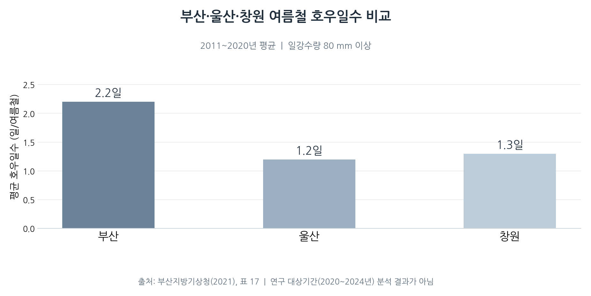

*그림 1.3.2. 부산·울산·창원의 평균 여름철 호우일수 비교(2011~2020년, 일강수량 80 mm 이상 기준). 자료: 부산지방기상청(2021), 표 17. 본 연구 대상기간의 분석 결과는 아니다.*

이처럼 동일 권역에 속하면서도 여름철 강수량과 호우 발생 빈도가 서로 다른 세 지역을 동일한 기준으로 비교하면, **지점에 따라 위성 추정 편차의 크기나 방향이 달라지는지를 확인할 수 있다**. 다만 과거 기후통계상의 강수 차이가 곧 GPM-IMERG 편차의 차이를 미리 입증하는 것은 아니며, 세 지점의 분석 결과를 동남권 전체로 일반화할 수는 없다.

### 1.4 주제 선정시 기준이 된 연구 질문과 세부목적별 필요성

위 내용을 종합하면 본 연구의 본질적 질문은 다음과 같다.
**GPM-IMERG와 ASOS의 일강수량 편차는 부산·울산·창원 지점별로, 그리고 ASOS 관측 강수 규모별로 어떻게 달라지는가?**

**세부목적 1. 두 자료의 일치도와 편차 산정.** 위성 강수자료를 활용할 수 있는지 판단하려면 먼저 기상 관측값과의 전반적인 일치도와 편차를 파악해 **이후의 비교 기준을 세워야 한다**.

**세부목적 2. 관측지점별 일치도 및 편차 크기와 과대·과소추정 경향 도출.** 전체적인 일치도와 편차만으로는 개별 관측지점의 추정 특성을 충분히 설명하기 어렵다. 예를 들어 한 지점에서 과대추정, 다른 지점에서 과소추정이 나타난다면 전체 평균에서는 이러한 차이가 상쇄될 수 있다. 따라서 **지점별 일치도와 편차의 크기뿐 아니라 과대·과소추정 경향을 따로 살펴보아야**, 전체 결과가 가릴 수 있는 개별 지점의 특성을 확인할 수 있다. 이는 가능한 상황을 설명한 예시이며 실제 결과를 미리 단정하지 않는다.

**세부목적 3. 지점별 GPM 격자의 지형 기복 및 강수 공간변동성과 GPM–ASOS 일강수량 편차의 관련성 확인.** 지점별 편차의 차이를 확인하는 것만으로는 GPM 격자 내부의 지형 기복 및 강수 공간분포와 편차가 어떠한 관련성을 보이는지 알기 어렵다. 따라서 **각 지점의 GPM 격자별 지형 기복과 편차의 크기·방향을 함께 살펴보고**, **격자 내부 강수 공간변동성과 GPM–ASOS 일강수량 절대편차의 상관관계를 확인**하여 편차의 공간적 관련성을 추가로 파악할 필요가 있다.

**세부목적 4. 강수 규모별 편차의 지점별 변화 양상 도출.** 약한 비와 강한 비에서 추정 편차가 다르게 나타날 수 있어, 지점 평균만으로는 드러나지 않는 **규모별 변화를 각 지점에서 확인할 필요가 있다**.

### 1.5 본 연구의 의의 및 해석 범위

본 연구는 동일한 여름철 일강수량 기준 아래 부산·울산·창원 세 관측지점의 GPM-IMERG 추정 편차를 지점별·강수 규모별로 교차 검증함으로써, 동남권 강수 분석에서 위성 강수자료를 활용할 때 유의해야 할 지점 및 강수 조건별 오차 특성을 정량적으로 제시하는 데 의의가 있다. 다만 본 분석은 2020-2024년 여름철(6-8월) 3개 관측지점을 대상으로 수행되었으므로, 도출된 편차 경향은 동남권 여름철 조건에 한정하여 해석해야 하는 한계가 있으며 다른 계절이나 전국 단위의 일반적인 특성으로 확대 적용할 수는 없다.또한 강수 해석에 필요한 편차 특성을 제시하는 것에 그치며, 홍수 예측 성능이나 재난 피해 감소를 직접 입증하지 않는다.

### 연구배경 참고문헌

[1] 노컷뉴스, 부산 물폭탄에 피해 속출(2020.7.24). [원문](https://www.nocutnews.co.kr/news/5383874)

[2] 이투데이, 시간당 80mm 물폭탄 쏟아진 부산(2020.7.24). [원문](https://www.etoday.co.kr/news/view/1921777)

[3] 서울신문, 환경부 2020년 8월 댐 하류 수해 원인조사 발표(2021.8.4). [원문](https://m.go.seoul.co.kr/news/2021/08/04/20210804009016)

[4] 트윅, 합천군 합천댐 수위조절 실패 주장(2020.8.10). [원문](https://www.twig24.com/news/local_gs/kynam_gs/2020/08/10/20200810500173)

[5] 한국법률일보, 2020년 8월 홍수 피해 17개 시·군 배상(2022.3.22). [원문](https://www.lawfact.co.kr/news_proc/news_contents.jsp?ncd=2821)

[6] 한국수자원공사, 2021 지역문제해결 자료. [원문](https://www.kwater.or.kr/danbitoktok/down/localsolving/2021_localProblemSolving_01.pdf)

[7] 뉴시스, 426mm 물폭탄 부산(2024.9.22). [원문](https://www.newsis.com/view/NISX20240922_0002894352)

[8] 세계일보, 창원 529mm(2024.9.22). [원문](https://www.segye.com/newsView/20240922509294)

[9] 대한토목학회 학술발표(2017), 수자원 이용현황과 강우 집중. [원문](https://koreascience.kr/article/CFKO201732863556270.pdf)

[10] 노컷뉴스, 쩍쩍 갈라진 저수지, 짙어진 녹조…경남. [원문](https://nocutnews.co.kr/news/6561251)

[11] 김덕환 외(2023), 관개회귀수량 산정방법론, 한국수자원학회 학술발표회. [원문](https://koreascience.or.kr/article/CFKO202323654233246.pdf)

[12] 수력발전 비중(KOSIS 2023 인용), 한국방재학회 등. [원문](https://koreascience.kr/article/JAKO202423957696572.pdf)

[13] 기상청 기상자료개방포털, 「종관기상관측(ASOS)자료 및 지점정보」. [원문](https://data.kma.go.kr/data/grnd/selectAsosRltmList.do)

[14] NASA, How is GPM data used in real-world application?. [원문](https://gpm.nasa.gov/resources/faq/how-gpm-data-used-real-world-applications)

[15] NASA(2023), *IMERG V07 Technical Documentation*. [원문](https://gpm.nasa.gov/resources/documents/imerg-v07-technical-documentation)

[16] Google Earth Engine Data Catalog, *NASA/GPM_L3/IMERG_V07*. [원문](https://developers.google.com/earth-engine/datasets/catalog/NASA_GPM_L3_IMERG_V07)

[17] 이주원·이은희(2018), 「동아시아 및 남한 지역에서의 Integrated MultisatellitE Retrievals for GPM (IMERG) 일강수량의 지상관측 검증」, 『대기』, 28(3), 273–289. [원문](https://doi.org/10.14191/Atmos.2018.28.3.273)

[18] 백종진 외(2018), 「GPM 위성 강우자료의 검증과 지상관측 자료를 통한 강우 보정 기법」, 『한국수자원학회논문집』, 51(2). [원문](https://doi.org/10.3741/JKWRA.2018.51.2.131)

[19] 정임국 외(2024), *Accuracy Assessment of Precipitation Products from GPM IMERG and CAPPI Ground Radar over South Korea*, 『대한원격탐사학회지』, 40(3), 269–274. [원문](https://doi.org/10.7780/kjrs.2024.40.3.3)

[20] 부산지방기상청(2021.06.09), 「신평년(1991-2020년) 대비 최근 10년(2011-2020년) 여름철 부울경 기후특성」, 표 11·17. [보도자료 및 PDF](https://www.kma.go.kr/busan/html/news/notice_view.jsp?articleno=11651&boardId=press2&pageNo=1)

## 2. 연구 질문 {#question}

앞서 제시한 강수정보의 사회적·경제적 활용 가치와 GPM-IMERG 및 ASOS 간 편차 검토의 필요성을 바탕으로, 본 연구에서 확인하고자 하는 내용을 네 가지 연구질문으로 구체화하였다. 각 연구질문은 문제의식을 나타내는 일상적 질문과 분석 대상 및 비교 조건을 명시한 학술적 연구질문으로 구성하였으며, 연구질문 1~4는 다음 절의 세부목적 1~4에 각각 대응한다.

### 2.1 연구 질문 1

- **일상적 질문:** “위성으로 측정한 강수량은 실제 지상에서 관측한 강수량과 얼마나 비슷할까?”
- **학술적 연구 질문:** 2020~2024년 여름철 부산·울산·창원 3개 관측지점에서 GPM-IMERG 추정 일강수량과 ASOS 관측 일강수량 간의 전반적인 일치도와 편차는 어느 정도인가?

### 2.2 연구 질문 2

- **일상적 질문:** "같은 위성자료를 사용하더라도 지역에 따라 실제 강수량과의 차이가 다르게 나타날까?"
- **학술적 연구 질문:** 2020~2024년 여름철 부산·울산·창원 3개 관측지점에서 GPM-IMERG와 ASOS 일강수량 간의 일치도 및 편차 크기와 과대·과소추정 경향은 지점별로 어떠한 차이를 보이는가?

### 2.3 연구 질문 3

- **일상적 질문:** "지형이 서로 다른 지역에서는 위성 강수량의 과대·과소추정이 다르게 나타날까? 격자 안에서 강수량이 고르지 않게 분포할수록 위성과 지상 관측값의 차이도 커질까?"
- **학술적 연구 질문:** 2020~2024년 여름철 부산·울산·창원 3개 관측지점이 포함된 GPM 격자의 지형 기복과 지점별 GPM-IMERG 및 ASOS 일강수량 편차의 크기·방향은 어떠한 양상을 보이며, 선정된 공통 강수일 100일에서 격자 내부 강수 공간변동계수와 GPM–ASOS 일강수량 절대편차 사이에는 어떠한 상관관계가 나타나는가?

### 2.4 연구 질문 4

- **일상적 질문:** "위성은 약한 비와 강한 비를 비슷한 수준으로 추정할까? 지역에 따라서도 그 차이가 달라질까?"
- **학술적 연구 질문:** ASOS 관측 일강수량을 기준으로 강수 규모를 구분했을 때, GPM-IMERG와 ASOS 간의 편차는 강수 규모에 따라 어떠한 변화 양상을 보이며, 이러한 변화는 부산·울산·창원 관측지점별로 어떻게 다른가?

## 3. 연구 목적 {#objectives}

  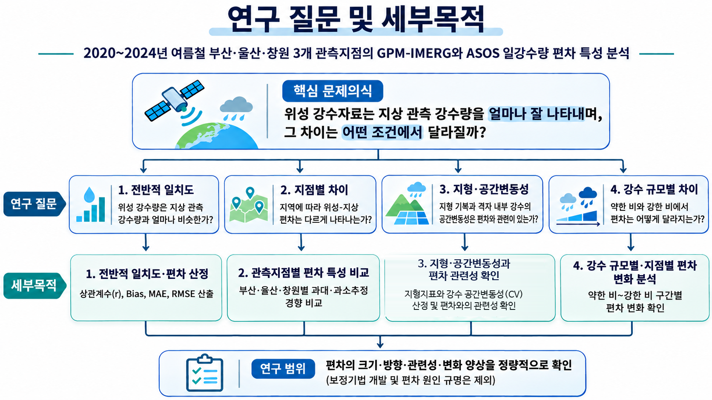

*그림 3.1. 연구질문과 세부목적 1~4의 대응 관계 및 전체 연구 구성. 전반적인 일치도와 편차 산정, 관측지점별 편차 분석, 지형 기복·강수 공간변동성과 편차의 관련성 확인, 강수 규모별 편차 변화 분석의 흐름을 나타낸다.*

### 3.1 전체 연구 목적

본 연구는 2020~2024년 여름철(6~8월) 부산·울산·창원 3개 관측지점에서 GPM-IMERG 위성 추정 일강수량과 ASOS 지상 관측 일강수량(무강수일 포함)을 비교하여, 두 자료 간의 전반적인 일치도와 편차를 정량적으로 분석하는 것을 목적으로 한다. 특히 관측지점과 ASOS 관측 강수 규모에 따른 편차의 크기와 방향을 비교하고, 과대·과소추정 경향 및 편차의 변화 양상을 파악하여 GPM-IMERG 자료를 활용할 때 고려해야 할 사항을 도출하고자 한다. 아울러 각 관측지점이 포함된 GPM 격자의 지형 기복과 지점별 편차의 양상을 살펴보고, 격자 내부 강수 공간변동성과 GPM–ASOS 일강수량 절대편차의 상관관계를 확인하고자 한다.

본 연구는 새로운 강수자료 보정 기법을 개발하거나 강수 규모가 편차를 발생시키는 원인을 규명하는 것을 목적으로 하지 않는다. 관측된 편차를 바탕으로 자료 간 차이와 변화 양상을 분석하는 데 초점을 둔다. 또한 부산·울산·창원 3개 지점의 5개 여름철 자료를 대상으로 하므로 연구 결과의 해석 범위를 동남권 여름철로 한정하며, 전국이나 다른 계절로 일반화하지 않는다. 홍수 예측 성능이나 재난 피해 감소 효과를 직접 검증하는 것 역시 연구 범위에 포함하지 않는다.

이러한 연구 목적을 달성하기 위해 세부목적을 네 단계로 구성하였다. 먼저 두 자료 간의 전반적인 일치도와 편차를 산정하여 이후 비교의 기준을 마련한다(세부목적 1). 다음으로 관측지점별 일치도와 편차의 크기 및 방향을 비교하여 전체 결과만으로는 구분하기 어려운 지점 간 차이를 확인한다(세부목적 2). 이어 각 관측지점이 포함된 GPM 격자의 지형 기복과 일강수량 편차의 지점별 양상을 살펴보고, 격자 내부 강수 공간변동성과 일강수량 절대편차의 상관관계를 확인한다(세부목적 3). 마지막으로 각 관측지점에서 강수 규모에 따른 편차의 변화 양상을 분석하여 지점별·강수 규모별 차이를 파악한다(세부목적 4). 이를 통해 전반적인 자료 간 차이 파악 → 관측지점별 편차 비교 → 지형 기복 및 강수 공간변동성과 편차의 관련성 확인 → 강수 규모에 따른 지점별 편차 변화 분석의 순서로 연구를 진행한다.

### 3.2 세부목적 1

**동일 관측일의 GPM-IMERG 추정 일강수량과 ASOS 관측 일강수량 간 일치도 및 편차 산정**

**연구 질문 1의 목적화.** 동일 관측일의 GPM-IMERG 추정 일강수량과 ASOS 관측 일강수량을 비교하여 두 자료 간의 전반적인 일치도와 편차를 산정한다.

**필요성 및 평가 지표.** 위성 강수자료를 활용할 때 지상 관측자료와 어느 정도 일치하는지 먼저 파악할 필요가 있다. 이를 통해 두 자료 간 전반적인 차이를 확인하고, 이후 관측지점 및 강수 규모별 비교를 위한 기준을 마련한다. 구체적으로는 두 자료 간 상관계수(r), 평균편차(Bias), 평균절대오차(MAE), 평균제곱근오차(RMSE)를 산출하여 전반적인 일치도와 오차 크기를 평가한다.

### 3.3 세부목적 2

**관측지점별 GPM-IMERG와 ASOS 일강수량 간의 일치도·편차 크기 산정 및 GPM-IMERG의 과대·과소추정 경향 도출**

**연구 질문 2의 목적화.** 부산·울산·창원 각 관측지점에서 두 자료 간의 일치도와 편차의 크기 및 방향을 비교하여 관측지점에 따른 차이를 파악한다.

**필요성 및 평가 지표.** 전체 자료를 통합한 결과만으로는 관측지점별 편차의 차이를 구분하기 어렵다. 

 
*그림 3.3.1. 전체 평균편차에서 관측지점별 과대·과소추정이 상쇄될 수 있음을 설명하는 개념도. 표시된 부산 +5mm, 울산 −5mm, 창원 0mm는 실제 연구 결과가 아닌 설명을 위한 가상의 예시이다.*

또한 GPM-IMERG는 격자 단위의 강수 추정자료이므로 관측지점의 지리적 환경과 강수의 공간적 분포에 따라 지상 관측값과의 편차가 다르게 나타날 가능성이 있다. 따라서 지점별 비교를 통해 과대·과소추정 경향과 편차 크기의 차이를 확인할 필요가 있다. 이를 위해 관측지점별 상관계수(r), 평균편차(Bias)의 부호 및 크기, MAE, RMSE와 과대·과소추정 발생 일수 비율을 비교하여 지점 간 추정 경향의 차이를 평가한다.

### 3.4 세부목적 3

**지점별 GPM 격자의 지형 기복 및 강수 공간변동성과 GPM–ASOS 일강수량 편차의 관련성 확인**

**연구 질문 3의 목적화.** 부산·울산·창원 관측지점이 포함된 GPM 격자의 지형 기복을 정량화하고, 지점별 GPM-IMERG와 ASOS 일강수량 편차의 크기 및 방향과 함께 살펴본다. 또한 선정된 공통 강수일 100일을 대상으로 격자 내부 강수 공간변동성을 산정하고, 강수 공간변동계수와 GPM–ASOS 일강수량 절대편차 사이의 상관관계를 확인한다.

**필요성 및 평가 지표.** 세부목적 2에서 산정한 관측지점별 편차만으로는 해당 지점이 포함된 GPM 격자의 지형 기복 및 강수 공간분포와 편차의 관련성을 확인하기 어렵다. 따라서 먼저 DEM을 활용하여 각 GPM 격자의 고도 표준편차, 평균 경사도, 고지대 면적 비율을 산정하고, 세 지점의 평균편차(Bias) 및 평균절대오차(MAE)와 함께 지점별 양상을 확인한다. 이어 기상청 500m 격자 강수자료를 이용하여 선정된 공통 강수일 100일(총 300개 지점·일 자료)의 강수 공간변동계수와 고지대·저지대 평균 강수량 차이를 산정한다. 이를 바탕으로 각 지점에서 강수 공간변동계수와 GPM–ASOS 일강수량 절대편차 사이의 스피어만 상관계수를 산출하여 격자 내부 강수의 공간적 변동성과 편차 크기의 관련성을 평가한다.

### 3.5 세부목적 4

**ASOS 관측 강수 규모에 따른 GPM-IMERG 추정 강수량 편차의 지점별 변화 양상 도출**

**연구 질문 4의 목적화.** ASOS 관측 일강수량을 기준으로 강수 규모를 구분하고, 각 관측지점에서 강수 규모에 따른 GPM-IMERG와 ASOS 간 편차의 크기와 방향을 비교하여 그 변화 양상을 분석한다.

**필요성 및 평가 지표.** 약한 강수와 강한 강수에서 편차의 크기와 방향이 다르게 나타날 가능성이 있으므로, 각 관측지점에서 강수 규모별 편차를 비교할 필요가 있다. 본 연구에서는 ASOS 관측 일강수량을 기준으로 0mm, 0mm 초과~10mm 미만, 10mm 이상~30mm 미만, 30mm 이상의 네 구간으로 구분하였다. 이를 바탕으로 강수 규모 구간별 표본 수, 평균편차(Bias), MAE, RMSE의 변화 양상을 비교하여 강수 규모에 따른 편차 특성을 평가한다.

## 4. 재료 {#materials}

### 4.1 연구 대상 및 기간

연구 대상은 부산(159), 울산(152), 창원(155)의 ASOS 관측지점 3곳이며, 기간은 2020~2024년 매년 여름철(6~8월)이다. 지점당 92일×5년=460일, 총 1,380개의 지점·일 자료를 사용하였다. 이 1,380행은 3개 지점에서 반복 관측한 값이므로 독립적인 1,380개 표본으로 해석하지 않는다. 같은 날 인접 지점의 강수는 동일한 기상 현상의 영향을 받을 수 있고, 같은 지점의 연속된 날도 서로 독립이 아닐 수 있다.

GPM-IMERG 격자값 추출에 사용한 ASOS 관측소 좌표는 다음과 같다.

  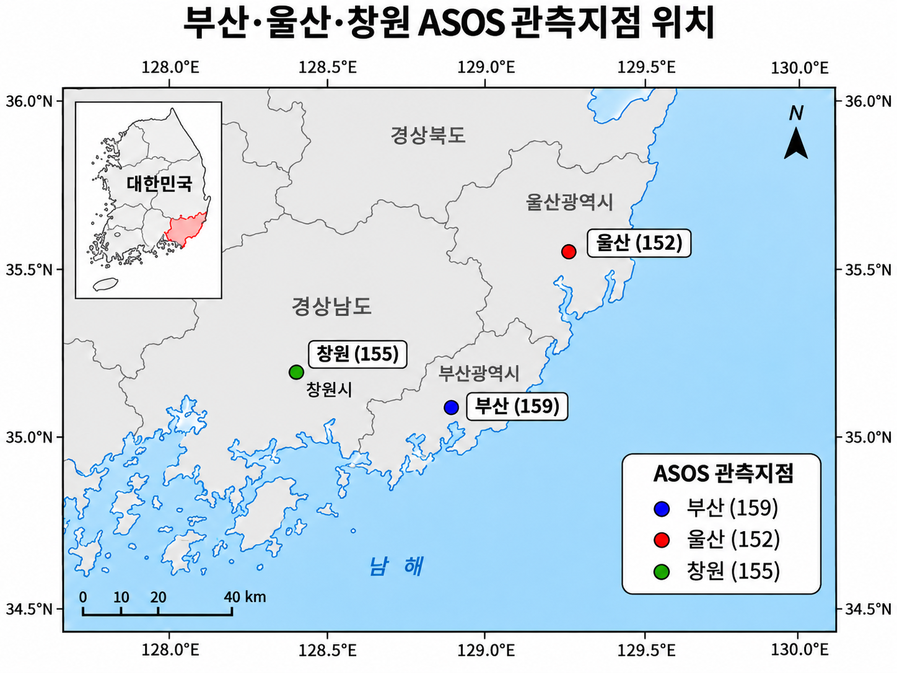

*그림 4.1.1. 부산(159), 울산(152), 창원(155)의 ASOS 관측지점 위치를 나타낸 개념도.*

*표 4.1.1. 부산·울산·창원 ASOS 관측지점의 위치 및 지점번호*

| **관측지점** | **ASOS 지점번호** | **위도 (북위, °N)** | **경도 (동경, °E)** |
|:---:|:---:|---:|---:|
| **부산** | `159` | `35.10468° N` | `129.03203° E` |
| **울산** | `152` | `35.58237° N` | `129.33467° E` |
| **창원** | `155` | `35.17019° N` | `128.57282° E` |

### 4.2 ASOS 지상 관측자료

기상청 기상자료개방포털(data.kma.go.kr)의 종관기상관측(ASOS) 일자료에서 3개 지점의 일평균기온(°C)과 일강수량(mm)을 내려받았다. ASOS는 정해진 시각에 전 관측소에서 같은 방식으로 실시하는 지상관측이며, 포털은 분·시간·일·월·연 단위 자료를 제공한다. 내려받은 파일은 2020년 6월 1일부터 2024년 8월 31일까지 지점당 1,553일(총 4,659행)이며 여름철 외 달도 포함하므로 각 연도의 6~8월 1,380행만 추출하였다. 일평균기온은 강수 편차 산정에 사용하지 않고 일강수량 공란의 품질 관리에 참고하는 보조변수로 활용하였다.

일강수량은 지상에서 관측한 값으로, 격자 기반 강수 추정자료인 GPM-IMERG와 달리 점 관측이다. 따라서 GPM-IMERG 추정값을 평가하는 기준 자료로 쓰되, 점과 격자의 대표 범위 차이를 해석에 반영한다.

### 4.3 GPM-IMERG 위성 강수자료

NASA GPM-IMERG V07(Integrated Multi-satellitE Retrievals for GPM, Release 07)을 Google Earth Engine의 `NASA/GPM_L3/IMERG_V07`에서 불러왔다. 자료 제공처는 NASA 고다드 지구과학 자료정보서비스센터(GES DISC)이며, 여러 위성의 마이크로파·적외선 관측을 결합해 전 지구 격자의 강수량을 추정하는 자료이다. 원자료의 공간해상도는 0.1°×0.1°이고 Earth Engine에서는 픽셀 크기 11,132 m로 제공된다. 연구 지역(북위 약 35°)에서는 위도 방향 약 11 km, 경도 방향 약 9 km에 해당하므로 격자가 정사각형이 아니다. 시간해상도는 30분이며 강수율(mm/hr) 단위이다.

보정 강수(precipitation)를 주 분석 자료로 사용하였으며, 비보정 강수(precipitationUncal)는 전체 1,380건을 대상으로 동일한 통계지표를 산출하여 보조적으로 검토하였다. 각 관측소 좌표가 포함된 0.1° 격자의 픽셀값을 Google Earth Engine의 `ee.Reducer.first()`로 추출하였으며, 추출 설정은 `scale=11132`(m), `EPSG:4326`을 사용하였다.

ASOS 일강수량과 동일하게 한국시간(KST) 00:00~다음 날 00:00을 하루로 정의하였다. 이를 위해 GPM-IMERG의 UTC 기준 시간을 KST 날짜에 맞추어, 해당 KST 날짜의 전날 UTC 15:00부터 당일 UTC 15:00 직전까지의 30분 간격 자료 48개를 집계하였다(코드상 날짜 경계에 `.advance(-9, 'hour')` 적용).

원자료의 강수율 단위는 mm/hr이므로 각 30분 간격 강수율에 0.5시간을 곱한 값을 모두 합산하여 일 누적 강수량(mm)으로 환산하였다. 산출식은 다음과 같다.

$$
\mathrm{GPM}_d = \sum_{j=1}^{48}\left(R_{d,j}\times 0.5\,\mathrm{h}\right)
$$

여기서 `GPM_d`는 KST 기준 날짜 d의 GPM-IMERG 일강수량(mm), `R_{d,j}`는 해당 날짜의 j번째 30분 간격 강수율(mm/hr)이다. 각 강수율에 0.5시간을 곱해 48개를 합산하였다. 공통 통합자료의 `half_hour_count`를 확인한 결과, 1,380개 지점·일 모두 48개의 시간대가 빠짐없이 포함되었다.

*표 4.3.1. ASOS와 GPM-IMERG V07 자료의 특성 비교*

| **비교 항목** | **ASOS (지상 관측)** | **GPM-IMERG V07 (위성 추정)** |
|:---|:---|:---|
| **자료 출처** | 기상청 기상자료개방포털 | NASA GES DISC (Google Earth Engine 경유) |
| **관측 방식** | 관측소에서 측정하는 **점 관측** | 여러 위성 관측을 결합한 **격자 추정** |
| **공간 단위** | 부산·울산·창원 **3개 지점** | **0.1° × 0.1° 격자** (남북 약 11 km / 동서 약 9 km) |
| **시간 단위** | **일 단위** | **30분 간격** → KST 기준 일 단위 집계 |
| **강수량 단위** | **mm** (일강수량) | **mm/hr** (강수율) → **mm** (일강수량) |
| **사용 기간** | **2020~2024년, 매년 6~8월** | **2020~2024년, 매년 6~8월** |
| **연구에서의 역할** | **기준 자료** | **평가 대상** |

### 4.4 공통 통합자료

원본 ASOS·GPM-IMERG 자료를 수집한 뒤 전처리와 검증을 거쳐 공통 통합자료(마스터 파일)를 구축하였다. 두 자료를 지점·날짜 기준으로 결합하여 1,380행 16개 변수의 파일(`MASTER_GPM_ASOS_2020_2024_JJA_1380_corrected.csv`)을 만들었으며, 부산 460행, 울산 460행, 창원 460행으로 구성된다. 결합 시 누락이나 중복 없이 1,380행이 모두 대응되었다. 세부목적 1·2·4는 공통 통합자료 1,380건을 기준으로 분석하였으며, 세부목적 3에서는 공통 통합자료에서 선정한 100일·300건의 지점·일 자료에 지형 및 격자 강수자료를 추가로 결합하여 분석하였다.

*표 4.4.1. 공통 통합자료의 주요 변수 구성*

| 구분 | 변수명 | 의미 |
|:---|:---|:---|
| 날짜·지점 | `year`, `month`, `stn`, `name_kr`, `date_kst` | 연도, 월, ASOS 지점번호, 관측지점명, 날짜(KST 기준) |
| ASOS 자료 | `temp_avg_c`, `asos_mm_raw`, `asos_mm_filled` | 일평균기온(°C), 일강수량 원값 및 공란 0 mm 처리값 |
| 강수 규모 | `rain_category` | ASOS 일강수량 기준 강수 규모 구분 |
| GPM 자료 | `gpm_cal_mm`, `gpm_uncal_mm` | GPM-IMERG 보정·비보정 일강수량(mm) |
| 자료 검증 | `half_hour_count` | 하루 집계에 사용된 30분 간격 자료 수 |
| 오차 지표 | `bias_cal`, `abs_err_cal`, `sq_err_cal`, `bias_uncal` | 보정 자료의 편차·절대오차·제곱오차 및 비보정 자료의 편차(GPM − ASOS) |

### 4.5 지형 및 격자 강수자료

세부목적 3에서는 부산·울산·창원 관측지점이 포함된 GPM-IMERG 격자의 지형 기복 및 강수 공간변동성과 GPM–ASOS 일강수량 편차의 관련성을 확인하기 위해 Copernicus DEM과 기상청 500m 격자 강수자료를 추가로 활용하였다. 지형자료는 GPM 격자 내부의 고도 및 경사도 분포를 파악하는 데 사용하였으며, 격자 강수자료는 동일한 공간 범위에서 강수량의 공간적 분포를 파악하는 데 사용하였다.

**지형자료**는 Google Earth Engine에서 제공하는 Copernicus DEM GLO-30을 사용하였다. 해당 자료는 약 30m 공간해상도의 전 지구 고도자료로, 지표면의 건물과 식생 등이 포함될 수 있는 디지털표면모델(DSM)이다. 본 연구에서는 각 ASOS 관측지점이 포함된 GPM-IMERG 0.1° × 0.1° 격자를 분석 범위로 설정하고, DEM의 고도정보와 경사도 자료를 이용하여 지형 기복 지표를 산정하였다. 분석에서는 해발고도 150m를 기준으로 고지대와 저지대를 구분하였으며, 고도 표준편차, 평균 경사도 및 고지대 면적 비율을 주요 지표로 사용하였다.

**격자 강수자료**는 기상청 API허브의 「고해상도 격자자료 조회(해상도: 500m)」 서비스에서 제공하는 일강수량(`rn_day`) 자료를 사용하였다. 해당 자료는 기상청 및 관계기관의 관측자료를 바탕으로 객관분석 기법을 적용하여 생산한 격자형 분석자료로, 각 500m 격자점에서 직접 관측한 강수량을 의미하지는 않는다. 본 연구에서는 격자별 강수량의 공간적 차이를 확인하기 위한 보조자료로 활용하였다.

강수 공간분포 분석에는 2020~2024년 여름철 중 공통 기준에 따라 선정한 100일을 사용하였다. 각 날짜에 부산·울산·창원 3개 지점의 자료를 대응시켜 총 300개의 지점·일 분석자료를 구성하였다. 각 GPM 격자 내부에서 분석에 포함된 육지 격자점은 부산 366개, 울산 353개, 창원 332개이며, 이 격자점의 일강수량을 이용하여 강수 공간변동계수와 고지대·저지대 평균 강수량 차이를 산정하였다. 지형 구분과 격자점 추출 기준, 분석일 선정 과정 및 지표 산정 방법은 5.4절에 제시한다.

*표 4.5.1. 세부목적 3의 추가 자료 및 분석 목적*

| 자료 | 제공처 및 자료명 | 공간해상도 | 분석 목적 |
|:---|:---|:---:|:---|
| 지형자료 | Copernicus DEM GLO-30 (Google Earth Engine) | 약 30m | GPM 격자 내부 고도 표준편차, 평균 경사도, 고지대 면적 비율 산정 |
| 격자 강수자료 | 기상청 고해상도 격자자료(`rn_day`) | 약 500m | 격자 내부 강수 공간변동계수 및 고지대·저지대 강수량 차이 산정 |
| GPM–ASOS 통합자료 | 본 연구의 공통 통합자료 | 지점·일 단위 | 지형 및 강수 공간분포 지표와 GPM–ASOS 편차 연결 |

Copernicus DEM은 위성 강수량을 나타내는 자료가 아니라 지형을 나타내는 자료이며, 기상청 500m 격자 강수자료도 ASOS 관측값과 동일한 직접 관측자료는 아니다. 또한 500m 격자 강수 분석에는 육지 격자점만 사용하였으므로, 그 평균값을 해역까지 포함한 GPM 격자 전체의 평균 강수량으로 해석하지 않는다.

**자료 출처**

- [Google Earth Engine, Copernicus DEM GLO-30](https://developers.google.com/earth-engine/datasets/catalog/COPERNICUS_DEM_GLO30)
- [기상청 API허브, 고해상도 격자자료 조회(해상도: 500m)](https://apihub.kma.go.kr/apiList.do?seqApi=971)

### 4.6 결측 및 품질 관리

ASOS 일강수량 원값은 1,380행 중 689행(49.9%)이 빈칸이며, 값이 기록된 691행 중 139행은 0.0 mm, 552행은 0.1 mm 이상이다. 빈칸은 무강수로 간주하여 0.0 mm로 대체하였다(`asos_mm_filled`). 이 처리의 근거는 두 가지이다. 첫째, 일평균기온이 전 건 정상 관측되었다. 둘째, 45개 연·월·지점 조합의 기상청 공식 월강수량 합계와 대조하여 일치함을 확인하였다([월강수량 검증 결과 CSV](./assets/asos_monthly_validation_2020_2024_JJA.csv)). 빈칸 689일의 GPM 보정 일강수량은 평균 0.47 mm이고 10 mm 이상인 날은 2일(최대 22.3 mm)이므로 대체로 일관되나, 이 2일은 실제 강수의 누락일 가능성을 배제하지 못한다. 또한 일평균기온 관측과 월강수량 합계 일치만으로 개별 관측일의 모든 강수량 결측 가능성을 완전히 배제할 수 없으므로, 본 연구의 분석 결과는 공란을 0 mm로 대체한 전처리 가정에 의존한다.

강수 규모는 ASOS 일강수량 기준으로 무강수(0 mm, 828일), 약한 비(0 mm 초과~10 mm 미만, 289일), 보통 비(10 mm 이상~30 mm 미만, 124일), 강한 비(30 mm 이상, 139일)의 4단계로 구분하였다. 경계값은 하한을 포함하고 상한은 포함하지 않는 방식으로 처리하였다. 다만 위 구간의 ‘약한 비·보통 비·강한 비’라는 명칭은 본 연구의 비교를 위한 편의상 분류이며, 공식적인 강수 강도 등급을 의미하지 않는다.

### 4.7 자료의 한계

GPM-IMERG는 점이 아닌 약 11 km 격자의 추정값이므로 두 자료의 차이에는 위성 추정 오차와 공간 대표성 차이가 섞여 있다. 3개 관측지점의 결과를 해당 도시 전체나 동남권 전체 및 다른 지역으로 일반화하지 않는다.

## 5. 방법 {#method}

### 5.1 기초 탐색

4장에서 제시한 ASOS 및 GPM-IMERG 자료의 수집, 시간 기준 통일, 일강수량 집계, 결측 처리 및 지점·날짜별 결합 과정을 거쳐 구축한 공통 통합자료를 분석에 사용하였다. 부산·울산·창원 3개 관측지점의 총 1,380개 지점·일 자료를 대상으로 기초 통계와 산점도를 통해 두 자료의 전반적인 대응 관계를 확인하였다.

전체 1,380건 중 ASOS 정제 일강수량이 0 mm인 자료는 828건이며, 여기에는 원자료의 공란 689건을 0 mm로 대체한 자료가 포함된다. 무강수일이 다수 포함된 경우 분석 대상의 구성에 따라 일치도 및 오차 지표가 달라질 수 있으므로, 다음 세 집단으로 구분하여 보조 비교를 수행하였다.

1. 전체 1,380건(ASOS 원자료 공란을 0 mm로 처리)
2. ASOS 원자료의 공란을 제외한 691건
3. ASOS 관측 강수일 552건(ASOS 일강수량 > 0 mm)

세 집단은 서로 독립적인 표본이 아니라 전체 자료에서 조건에 따라 분석 대상을 달리한 집단이며, 이를 통해 자료 포함 기준에 따른 통계값의 차이를 확인하였다.

### 5.2 세부목적 1의 분석: 일 단위 일치도와 편차 산정
동일 관측일의 두 값을 짝지어(asos_mm_filled, gpm_cal_mm) 다음 지표를 계산하였다. 편차는 공통 통합자료의 정의와 같이 GPM - ASOS이다.

$$
\mathrm{Bias} = \frac{1}{n}\sum_{i=1}^{n}(GPM_i-ASOS_i)
$$

$$
\mathrm{MAE} = \frac{1}{n}\sum_{i=1}^{n}|GPM_i-ASOS_i|
$$

$$
\mathrm{RMSE} = \sqrt{\frac{1}{n}\sum_{i=1}^{n}(GPM_i-ASOS_i)^2}
$$

$$
r = \frac{\sum_{i=1}^{n}(ASOS_i-\overline{ASOS})(GPM_i-\overline{GPM})}{\sqrt{\sum_{i=1}^{n}(ASOS_i-\overline{ASOS})^2\sum_{i=1}^{n}(GPM_i-\overline{GPM})^2}}
$$

여기서 n은 관측 건수이다. 평균편차(Bias)는 양수면 과대, 음수면 과소추정을 뜻하지만 부호가 다른 편차가 상쇄될 수 있으므로 MAE·RMSE와 함께 해석하였다. RMSE는 개별 오차를 제곱하여 계산하므로, 두 자료 간 편차가 큰 관측일의 영향을 상대적으로 크게 받는다. 상관계수는 일치의 방향과 선형성만 나타내며 값의 크기가 맞는지는 알려주지 않는다. 보정 강수자료(gpm_cal_mm)를 주 분석에 사용하였으며, 비보정 강수자료(gpm_uncal_mm)에 대해서도 전체 1,380건을 대상으로 동일한 통계지표를 산출하여 보조적으로 비교하였다. 지점별·강수 규모별 편차 분석은 보정 강수자료를 기준으로 수행하였다.

### 5.3 세부목적 2의 분석: 지점별 일치도·편차와 과대·과소추정 경향
부산·울산·창원 지점별로 5.2의 지표를 따로 계산하고, 편차의 분포와 과대·과소추정의 발생 비율을 함께 비교하여 지점별 경향을 판단하였다. 분석은 다음 네 가지로 구성하였다.

1. 지점별 지표 비교: 지점별 460일 자료로 r, Bias, MAE, RMSE를 산출하고, Bias와 MAE·RMSE를 함께 비교하여 부호가 다른 편차의 상쇄 여부를 확인하였다.
2. 편차 분포 비교: 편차(GPM - ASOS)의 분포를 지점별 박스플롯으로 비교하여 중앙값, 사분위수 범위, 극단적 호우 이상치의 영향을 확인하였다.
3. 과대·일치·과소추정 일수 비율 비교: 엄격 기준(GPM > ASOS는 과대, GPM = ASOS는 일치, GPM < ASOS는 과소)과 실질 기준(ASOS의 최소 단위 0.1 mm를 고려하여 편차의 절댓값이 0.1 mm 미만이면 일치로 간주)으로 지점별 발생 일수 비율을 비교하였다.
4. 보조 비교: 양쪽 모두 0 mm인 무강수일을 제외하고, 유효 강수일(ASOS > 0 mm 또는 GPM > 0 mm)만을 대상으로 위 지표를 다시 산출하였다.

지점별 지표는 각 지점의 460일 자료로 산출하였으며, 지점 간 차이는 지표 값을 나란히 놓고 크기를 비교하는 방식으로 기술하였다. 같은 날의 세 지점 값은 동일한 기상 상황의 영향을 받아 서로 독립이라고 보기 어려우므로, 지점 간 차이에 대한 통계적 검정은 수행하지 않았다. 또한 3개 지점만으로는 해안·내륙, 지형 등 지점 특성이 편차에 미치는 영향을 분리할 수 없다.

### 5.4 세부목적 3의 분석: 지형 기복 및 강수 공간변동성과 일강수량 편차의 관련성

세부목적 3에서는 부산·울산·창원 관측지점이 포함된 GPM 격자의 지형 기복을 정량화하고, 지점별 GPM–ASOS 일강수량 편차와의 관련성을 확인하였다. 또한 기상청 500m 격자 강수자료를 이용하여 격자 내부 강수 공간변동성을 산정하고, GPM–ASOS 일강수량 절대편차와의 상관관계를 분석하였다.

**1. 분석 대상 및 지형 기복 산정**

지형 분석은 부산(159), 울산(152), 창원(155) 관측지점이 포함된 GPM 0.1° × 0.1° 격자 3개를 대상으로 수행하였다. Copernicus DEM GLO-30에서 고도 0m 초과 영역을 추출하고, 격자별 고도 표준편차와 평균 경사도를 산정하였다. 또한 해발 150m 이상을 고지대로 분류하여 전체 유효 DEM 격자 중 고지대가 차지하는 비율을 계산하였다. 산정한 지형지표는 세부목적 2에서 도출한 각 지점의 460일 평균편차(Bias) 및 평균절대오차(MAE)와 함께 제시하여 지점별 양상을 확인하였다.

**2. 강수 공간변동성 산정**

2020~2024년 여름철 중 세 지점 모두 ASOS 일강수량이 1mm 이상이고, GPM 30분 간격 자료 48개가 확보된 공통 날짜를 선정하였다. 이 중 사전에 지정한 태풍 영향 가능 기간(2020.8.9.~8.10., 2021.8.23.~8.24., 2023.8.8.~8.11.)에 해당하는 날짜를 제외하여 최종 100일, 총 300개 지점·일 자료를 분석하였다.

각 날짜의 23:55 KST 기상청 500m 격자 일강수량(`rn_day`)을 이용하여 GPM 격자 내부의 육지 격자점(고도 0m 초과)을 추출하였다. 분석에 사용한 고정 격자점은 부산 366개, 울산 353개, 창원 332개이다.

격자 내부 강수량의 공간적 차이를 정량화하기 위해 다음과 같이 공간변동계수(CV)를 산정하였다.

$$
CV_{s,d}=\frac{\sigma_{s,d}}{\overline{P}_{s,d}}\times100
$$

여기서 \(\sigma_{s,d}\)는 지점 \(s\)의 날짜 \(d\)에 대한 500m 격자 강수량의 공간표준편차(mm), \(\overline{P}_{s,d}\)는 해당 격자의 평균 강수량(mm)이다.

또한 해발 150m를 기준으로 고지대와 저지대를 구분하고, 두 집단의 평균 강수량 차이(\(\overline{P}_{H}-\overline{P}_{L}\))와 그 절댓값을 산정하였다.

**3. GPM–ASOS 편차와의 관련성 확인**

선정된 100일의 날짜별 GPM–ASOS 일강수량 편차를 기존 공통 통합자료에서 추출하고, 동일 날짜·지점의 강수 공간변동계수와 연결하였다. 일강수량 편차 및 절대편차는 다음과 같이 정의하였다.

$$
d_{s,d}=GPM_{s,d}-ASOS_{s,d}
$$

$$
AE_{s,d}=|d_{s,d}|
$$

이후 부산·울산·창원 각각의 100일 자료를 대상으로 강수 공간변동계수와 일강수량 절대편차 사이의 스피어만 순위상관계수(\(\rho\))를 산출하여 관계의 방향과 정도를 확인하였다.

지형 기복 지표는 지점별로 고정되어 있으므로 편차와의 지점별 양상을 확인하는 데 사용하였으며, 직접적인 상관분석은 수행하지 않았다. 분석자료의 날짜·지점 중복 및 누락 여부와 유효 격자점의 자료확보율을 확인한 결과, 최종 300건에서 중복·누락은 없었으며 자료확보율은 100%였다.

### 5.5 세부목적 4의 분석: 강수 규모별 편차의 지점별 변화

세부목적 4에서는 ASOS 관측 일강수량을 기준으로 강수 규모를 구분하고, 각 관측지점에서 GPM-IMERG 추정 일강수량의 편차가 강수 규모에 따라 어떻게 변화하는지 분석하였다. 공통 마스터 자료 1,380건(지점별 460건)을 사용하였으며, ASOS 정제 일강수량(`asos_mm_filled`)을 기준으로 **0 mm, 0 mm 초과~10 mm 미만, 10 mm 이상~30 mm 미만, 30 mm 이상**의 네 구간으로 분류하였다. 10 mm는 세 번째 구간에, 30 mm는 네 번째 구간에 포함하였다. 해당 구간은 본 연구의 비교를 위해 설정한 기준으로, 공식적인 강수 강도 등급을 의미하지 않는다.

각 관측지점·강수 구간에 속하는 자료를 대상으로 GPM-IMERG 보정 일강수량(`gpm_cal_mm`)과 ASOS 정제 일강수량의 차이를 이용해 5.2절에서 제시한 평균편차(Bias), 평균절대오차(MAE), 평균제곱근오차(RMSE)를 산정하였다. 먼저 각 지점에서 강수 규모에 따른 지표의 변화 양상을 비교하고, 이어 동일한 강수 구간에서 세 관측지점의 지표를 비교하여 지점별 편차의 방향과 크기 차이를 확인하였다. 분석 결과는 지점·구간별 표본 수와 함께 그래프로 시각화하였다.

추가로 각 강수 구간이 관측지점 전체 평균편차(Bias)에 기여하는 정도를 파악하기 위해 **강수 구간별 Bias 기여도**를 산정하였다. 산정식은 다음과 같다.

$$
C_k = \frac{n_k}{N}\times\mathrm{Bias}_k
$$

여기서 Cₖ는 해당 강수 구간의 전체 Bias 기여도(mm), nₖ는 해당 구간의 표본 수, N은 관측지점별 전체 표본 수(460건), Biasₖ는 해당 구간의 평균편차(mm)이다. 네 구간의 기여도를 합산하면 해당 관측지점의 전체 Bias와 같아지며, 이를 통해 세부목적 2에서 확인한 지점별 평균편차와 강수 규모별 편차 특성을 연결하여 분석하였다.

본 분석은 ASOS 관측 강수 규모에 따른 편차의 변화 양상을 비교하는 것으로, 강수 규모나 지역적 조건이 편차의 직접적인 원인임을 규명하는 것은 아니다.

### 5.6 재현성 및 해석상 유의점

본 연구의 세부목적 1·2·4는 동일한 공통 통합자료(`MASTER_GPM_ASOS_2020_2024_JJA_1380_corrected.csv`)의 1,380개 지점·일 자료를 기준으로 수행하였다. 세부목적 3에서는 공통 통합자료에서 선정한 100일·300건에 DEM 및 기상청 500m 격자 강수자료를 연결하여 분석하였다. 분석에 사용한 자료의 구성과 전처리 기준은 4장에, 세부목적별 지표 산정식과 분석 절차는 5.2~5.5절에 제시하였다. 이를 통해 각 세부목적의 분석 대상과 산정 기준을 확인할 수 있도록 하였다.

세부목적 1·2·4의 일치도·편차 지표는 관측된 1,380개 지점·일에서 계산한 값이며, 세부목적 3의 강수 공간변동성과 편차 상관분석은 별도로 선정한 100일·300건을 대상으로 수행하였다. 신뢰구간 등 불확실성 추정은 수행하지 않았다. 연속된 날과 같은 날의 인접 지점 값은 서로 독립이 아닐 수 있고, ASOS 점 관측과 약 11 km 격자 추정값의 대표성 차이에서 오는 불확실성은 지표에 분리되지 않은 채 포함되어 있다. 따라서 지점 간·강수 규모 간 차이는 크기를 기술한 것으로 해석한다.

ASOS 일강수량 원값의 공란 689건을 무강수로 간주해 0 mm로 대체하였으므로, 공란을 포함한 전체 자료 및 강수 규모별 분석 결과는 이러한 전처리 가정의 영향을 받을 수 있다.

## 6. 결과 {#results}

### 6.1 세부목적 1의 결과

### 6.1.1 연구 질문 및 분석 대상

**연구 질문 1.** 2020년부터 2024년 여름철 부산·울산·창원 3개 관측지점에서 GPM-IMERG 추정 일강수량과 ASOS 관측 일강수량 간의 **전반적인 일치도와 편차는 어느 정도인가?**

본 분석은 2020년부터 2024년까지 매년 6월부터 8월까지의 동일 날짜·지점에 대응하는 총 **1,380개 지점·일 자료**(부산 460건, 울산 460건, 창원 460건)를 통합하여 수행하였다. 위성자료는 GPM-IMERG 보정 일강수량(`gpm_cal_mm`), 지상자료는 ASOS 일강수량(`asos_mm_filled`)을 사용하였다. 편차(Bias)는 **GPM − ASOS**로 정의하였으며, 양수는 위성의 과대추정, 음수는 과소추정을 뜻한다.

ASOS 원본 일강수량의 공란 **689건**은 기상청의 강수량 기입 관행, 평균기온 관측 여부 및 45개 연·월·지점 조합의 월강수량 합계 대조를 근거로 0mm 처리하였다. 다만 평균기온 관측과 월별 합계 일치만으로 개별 우량계 관측의 모든 결측 가능성이 독립적으로 배제되는 것은 아니다. 아래 주 결과는 **공란=0mm 처리 기준**이다.

### 6.1.2 전체 일치도 및 편차

*표 6.1.1. GPM-IMERG 보정 강수자료와 ASOS 일강수량의 전체 일치도 및 편차* 

| 분석 지표 | 전체 분석 결과 |
|:--|--:|
| 자료 수(n) | **1,380건** |
| ASOS 평균 일강수량 | **9.05 mm** |
| GPM-IMERG 평균 일강수량 | **8.37 mm** |
| Pearson 상관계수(r) | **0.787** |
| 평균편차(Bias) | **−0.68 mm** |
| 평균절대오차(MAE) | **5.56 mm** |
| 평균제곱근오차(RMSE) | **15.00 mm** |

전체 자료에서 두 강수량 사이의 Pearson 상관계수는 **r=0.787**로 양의 상관관계를 보였다. 평균편차는 **−0.68mm**로 GPM 추정값이 ASOS 관측값보다 평균적으로 약간 낮았으나, MAE는 **5.56mm**, RMSE는 **15.00mm**였다. 즉, 양·음의 편차가 상쇄되어 평균편차가 작게 나타나더라도 개별 날짜의 강수량 차이가 작다고 볼 수는 없다. 또한 상관계수는 두 값의 동반 변화 정도를 나타낼 뿐, 두 자료의 수치상 일치 자체를 보장하지 않는다.

추가로 전체 1,380건을 대상으로 GPM-IMERG 비보정 강수자료(gpm_uncal_mm)를 보조적으로 비교한 결과, Pearson 상관계수(r)는 0.779, 평균편차(Bias)는 −1.72 mm, 평균절대오차(MAE)는 5.57 mm, 평균제곱근오차(RMSE)는 15.55 mm로 나타났다. 보정 강수자료는 비보정 자료보다 상관계수가 높고 Bias의 절댓값과 MAE·RMSE가 작았으나, 특히 MAE의 차이는 0.01 mm로 매우 작았다. 본 연구의 주요 결과와 그림은 보정 강수자료를 기준으로 제시하였다.

### 6.1.3 GPM-IMERG와 ASOS 일강수량 산점도

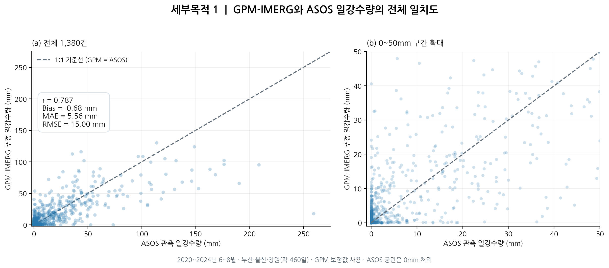

*그림 6.1.1. 2020~2024년 여름철 부산·울산·창원 전체 1,380건의 ASOS 관측 일강수량(가로축)과 GPM-IMERG 추정 일강수량(세로축) 비교. (a)는 전체 강수량 범위, (b)는 두 축의 0–50mm 구간을 확대한 산점도이다. 점선은 두 값이 같은 1:1 기준선(y=x)이며, (b)에는 확대 범위 밖의 관측점이 표시되지 않는다.*

산점도에서는 전체적으로 강수량이 함께 증가하는 경향이 관찰되지만, 1:1 기준선에서 크게 벗어난 자료도 확인된다. 특히 ASOS 강수량이 큰 일부 사례에서 위성 추정값이 크게 낮게 나타났다. **이러한 개별 사례만으로 강한 강수에서 항상 과소추정된다고 단정하지 않으며**, 강수 규모에 따른 편차의 변화는 세부목적 4에서 별도로 분석한다.

### 6.1.4 전체 편차 분포와 극단 사례

*그림 6.1.2. 전체 1,380개 지점·일 자료에서 산출한 편차(GPM − ASOS)의 분포. (a)는 극단적인 편차를 포함한 전체 범위, (b)는 −25mm부터 +25mm까지의 구간을 확대한 분포이다. 양의 편차는 위성 과대추정, 음의 편차는 위성 과소추정을 뜻하며, (b)에는 확대 범위 밖의 자료가 표시되지 않는다.*

전체 편차의 분포에는 큰 음의 편차를 보이는 관측값이 포함되어 있다. 예를 들어 **2023년 7월 16일 부산**의 ASOS 일강수량은 **259.20mm**, GPM-IMERG 추정값은 **17.62mm**로 편차는 **−241.58mm**였다. 이 사례는 큰 편차가 RMSE에 미치는 영향을 보여주지만, 두 자료의 공간적 대표 범위·추정 방법·시간 집계 차이 가운데 무엇이 해당 편차를 발생시켰는지는 이 분석만으로 규명할 수 없다. 관측값은 임의로 제외하지 않고 전체 주 분석에 포함하였다.

### 6.1.5 분석 표본 선택에 따른 보조 비교

*표 6.1.2. 분석 표본 선택에 따른 일치도 및 오차 지표 비교*

| 지표 | 전체 1,380건 (공란=0mm 처리) | ASOS 원본 공란 제외 691건 | ASOS 관측 강수일 552건 (ASOS > 0mm) |
|:--|--:|--:|--:|
| Pearson r | **0.787** | **0.750** | **0.730** |
| Bias (mm) | **−0.68** | **−1.83** | **−2.81** |
| MAE (mm) | **5.56** | **10.64** | **12.80** |
| RMSE (mm) | **15.00** | **21.15** | **23.51** |

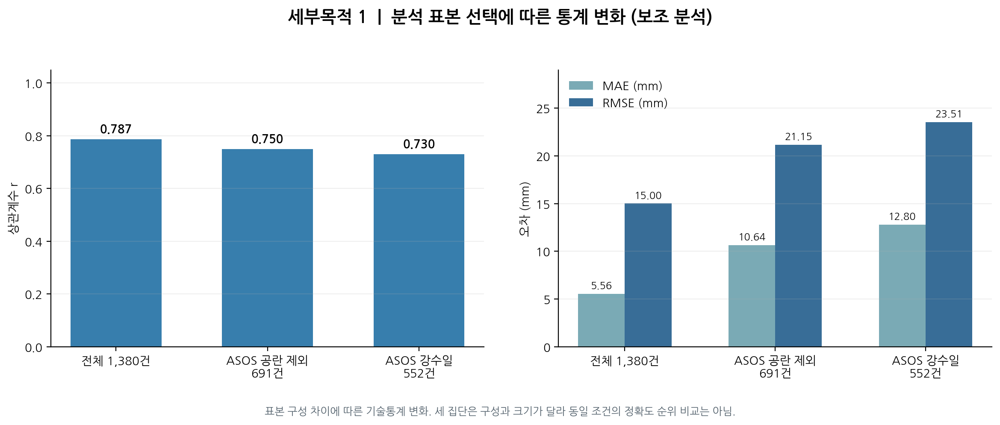

*그림 6.1.3. 분석 표본 선택에 따른 일치도 및 오차지표 비교. 전체 1,380건(ASOS 원본 공란을 0mm로 처리), 원본 강수량 공란을 제외한 691건(명시적 0.0mm 139건 포함), ASOS 관측 강수일 552건(ASOS > 0mm)을 각각 나타낸다. 서로 다른 표본을 비교한 결과이며 동일한 표본의 성능 변화가 아니다.*

ASOS 원본 강수량이 공란인 날짜를 제외한 **691건**에서는 r이 **0.750**, Bias가 **−1.83mm**, MAE가 **10.64mm**, RMSE가 **21.15mm**로 나타났다. 이 표본에는 원본에 0.0mm로 명시된 139건과 양의 강수량이 기록된 552건이 포함된다. ASOS 관측 강수일(**ASOS > 0mm**) **552건**만 선택하면 r은 **0.730**, Bias는 **−2.81mm**, MAE는 **12.80mm**, RMSE는 **23.51mm**였다.

세 표본의 통계 차이는 **분석에 포함되는 날짜와 강수 조건의 구성이 서로 다르기 때문**이며, 이를 같은 표본에서 위성 추정 성능 자체가 바뀐 것으로 해석해서는 안 된다. 특히 무강수 기록이 많이 포함된 전체 결과만으로 **ASOS 관측 강수일의 오차 규모**를 충분히 설명하기는 어렵다.

### 6.1.6 결과 요약 및 후속 연구와의 연결

세 지점의 5개 여름철을 통합하면 GPM-IMERG와 ASOS 일강수량 사이에 양의 상관관계(**r=0.787**)가 나타났으나, 평균편차(**−0.68mm**)와 달리 MAE(**5.56mm**) 및 RMSE(**15.00mm**)는 개별 날짜에 적지 않은 차이가 존재함을 보여주었다. 이러한 결과는 위성 강수자료를 지역 강수정보 분석에 활용할 때 **상관계수와 평균편차만으로 정확성을 판단해서는 안 되며**, 오차의 크기와 분석 조건을 함께 고려해야 함을 시사한다.

본 세부목적은 세 지점의 **전반적인 기준값**을 제시하는 단계이다. 따라서 전체 평균에 가려진 **관측지점별 차이**는 세부목적 2, **ASOS 강수 규모에 따른 지점별 편차 변화**는 세부목적 4에서 구분하여 분석한다. 본 연구는 강수자료 간 일치도와 편차를 평가한 것이며, 홍수예측 성능이나 재난 피해 감소 효과를 직접 검증한 것은 아니다.

### 6.2 세부목적 2의 결과

### 6.2.1 연구 질문 및 분석 대상
**연구질문 2.** 2020~2024년 여름철 부산·울산·창원 3개 관측지점에서 **GPM-IMERG와 ASOS 일강수량 간의 일치도 및 편차 크기와 과대·과소추정 경향은 지점별로 어떠한 차이를 보이는가?**

본 분석에서는 2020~2024년 여름철(6~8월) **부산(159), 울산(152), 창원(155)** 세 관측지점의 자료를 지점별로 나누어 일치도와 편차 특성을 비교하였다. 전체 1,380건 가운데 각 관측지점의 분석 일수는 동일하게 **460일**이다.

위성자료는 GPM-IMERG 보정 일강수량(gpm_cal_mm), 지상자료는 공란 689건을 0mm 처리한 ASOS 일강수량(asos_mm_filled)을 사용하였다. 편차는 **GPM-IMERG 추정값에서 ASOS 관측값을 뺀 값(GPM - ASOS)**으로 정의하였으며, 양수(+)는 위성의 **과대추정**, 음수(-)는 **과소추정**을 뜻한다.

### 6.2.2 관측지점별 일치도 및 편차 크기 비교

*표 6.2.1. 관측지점별 GPM-IMERG와 ASOS 일강수량의 일치도 및 편차 비교*

| 분석 지표 | 부산(159) | 울산(152) | 창원(155) | 전체 통합 |
| :--- | :---: | :---: | :---: | :---: |
| 자료 수(n) | 460건 | 460건 | 460건 | 1,380건 |
| ASOS 평균 일강수량(mm) | 10.61 | 7.01 | 9.53 | 9.05 |
| GPM-IMERG 평균 일강수량(mm) | 8.56 | 7.72 | 8.83 | 8.37 |
| Pearson 상관계수(r) | 0.788 | 0.822 | 0.795 | 0.787 |
| 평균편차(Bias, mm) | -2.06 | +0.71 | -0.70 | -0.68 |
| 평균절대오차(MAE, mm) | 6.55 | 4.42 | 5.72 | 5.56 |
| 평균제곱근오차(RMSE, mm) | 18.80 | 10.67 | 14.42 | 15.00 |

세 관측지점의 **상관계수(r)**는 울산 **0.822**, 창원 **0.795**, 부산 **0.788**로 모두 양의 상관관계를 보였다. 그러나 **평균편차(Bias)**는 지점별로 방향이 엇갈렸다. **부산(-2.06mm)**과 **창원(-0.70mm)**은 위성이 ASOS 관측값보다 적게 추정하는 음의 편차를 보인 반면, **울산(+0.71mm)**만 유일하게 양의 편차를 보였다. 세부목적 1의 전체 평균편차(-0.68mm)는 이처럼 서로 반대 방향인 지점별 편차가 합쳐져 상쇄된 결과이다.

일별 오차의 절대 크기를 나타내는 **MAE**와 **RMSE**는 **부산(6.55mm, 18.80mm)**이 가장 컸고, **창원(5.72mm, 14.42mm)**, **울산(4.42mm, 10.67mm)** 순으로 작아졌다. 특히 창원은 평균편차(-0.70mm)가 0에 가깝지만 개별 날짜의 오차 크기는 적지 않았다.

  

*그림 6.2.1. 2020~2024년 6~8월 부산·울산·창원 관측지점별 ASOS 관측 일강수량(가로축)과 GPM-IMERG 추정 일강수량(세로축) 비교. 점선은 두 값이 같은 1:1 기준선(y=x)이며, 각 지점의 표본 수는 460일이다.*

그림 6.2.1에서 세 지점 모두 비가 많이 올수록 점들이 1:1 기준선을 따라 함께 올라가지만, ASOS 일강수량이 **100mm를 넘는 큰 비에서는 점들이 기준선 아래쪽에 몰려 있다.** 즉, 강한 비가 내릴 때 위성 추정값이 지상 관측값보다 낮게 나타나는 경향이 확인된다.

  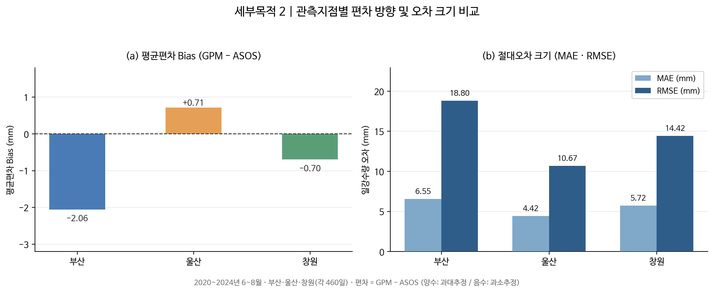

*그림 6.2.2. 관측지점별 GPM-IMERG와 ASOS 일강수량의 평균편차(Bias) 및 오차 크기(MAE, RMSE) 비교. 편차는 GPM-IMERG 추정값에서 ASOS 관측값을 뺀 값(mm)이다.*

그림 6.2.2를 보면 세 지점 모두 큰 오차에 민감한 RMSE가 MAE보다 2.4배 이상 크며, 특히 부산은 RMSE(18.80mm)가 두드러지게 높다. 다만 이 결과는 관측 기간의 자료 특성을 나타낸 것이며, **해안 인접성이나 지형 등 입지 조건을 오차의 직접적인 원인으로 단정하지 않는다.**

### 6.2.3 관측지점별 편차 분포와 극단 사례의 영향

지점별 일강수량 편차(GPM - ASOS)가 어떤 범위에 퍼져 있는지 확인하기 위해 박스플롯을 비교하였다.

  

*그림 6.2.3. 관측지점별 일강수량 편차(GPM - ASOS) 분포 비교. (a)는 극단 사례를 포함한 전체 편차 범위, (b)는 -10~+10mm 구간을 확대한 결과이며 붉은 마름모 표식은 지점별 평균편차(Bias)이다.*

그림 6.2.3(b)에서 세 지점 모두 편차의 제1사분위수(Q1)는 0mm이며, 중앙값은 부산 약 0.005mm, 울산 약 0.025mm, 창원 약 0.010mm로 **0mm에 매우 가깝다.** 제3사분위수(Q3) 역시 부산 약 0.87mm, 울산 약 1.33mm, 창원 약 0.98mm로 나타나, **편차 분포의 중심부가 0mm 부근에 집중**되어 있다. 즉, 전체 날짜의 절반이 모인 사분위수 상자 구간은 0mm 위쪽에 자리 잡고 있어 평소에는 위성이 지상보다 약간 높게 추정하는 날이 더 많다.

그럼에도 부산과 창원의 평균편차(붉은 마름모)가 0mm 아래로 내려간 데에는 그림 6.2.3(a)의 **큰 음의 편차 사례들**이 크게 기여하였다. **부산**에서는 2023년 7월 16일 사례(ASOS 259.20mm, GPM 17.62mm, **편차 -241.58mm**)를 포함해 **편차가 -100mm 이하인 큰 과소추정 사례가 2건** 확인되었으며, 이러한 큰 음의 편차가 전체 평균편차를 **-2.06mm**로 낮추는 데 기여하였다. **창원** 역시 **-124.2mm**를 포함한 큰 음의 편차 사례들의 영향으로 평균편차가 **-0.70mm**로 나타났다. 반면 **울산**에서는 부산·창원보다 극단적인 음의 편차 크기가 상대적으로 작았으며, 전체 평균편차는 **+0.71mm**로 양의 값을 보였다. 이 극단 사례들은 분석자료에서 확인된 값으로, 별도의 제외 기준 없이 전체 분석에 포함하였다.

### 6.2.4 관측지점별 과대·과소추정 발생 일수 비율

평균편차(Bias)는 소수의 극단적 강수 사례에 크게 영향을 받으므로, 전체 관측일 가운데 위성이 지상보다 높게 추정한 날(**과대추정**, GPM > ASOS), 같게 추정한 날(**일치**, GPM = ASOS), 낮게 추정한 날(**과소추정**, GPM < ASOS)의 발생 일수와 비율(**엄격 기준**)을 비교하였다. 또한 ASOS 지상 강수량의 최소 기록 단위가 0.1mm인 반면 위성은 0.01~0.09mm 수준의 미세 강수량을 산출하는 특성을 고려하여, 편차 절댓값이 0.1mm 미만인 경우를 일치로 간주한 **실질 기준**도 함께 산출하였다.

*표 6.2.2. 관측지점별 과대·일치·과소추정 발생 일수 및 비율 비교*

| 구분 | 평가 지표 | 부산(159) | 울산(152) | 창원(155) |
| :--- | :--- | :---: | :---: | :---: |
| 엄격 기준 | 과대추정 일수 및 비율(GPM > ASOS) | 236일 (51.3%) | 252일 (54.8%) | 238일 (51.7%) |
| 엄격 기준 | 일치 일수 및 비율(GPM = ASOS) | 124일 (27.0%) | 122일 (26.5%) | 113일 (24.6%) |
| 엄격 기준 | 과소추정 일수 및 비율(GPM < ASOS) | 100일 (21.7%) | 86일 (18.7%) | 109일 (23.7%) |
| 실질 기준 | 실질 과대추정 비율(편차 +0.1mm 이상) | 40.0% | 45.0% | 43.3% |
| 실질 기준 | 실질 일치 비율(편차 절댓값 0.1mm 미만) | 39.3% | 36.7% | 33.7% |
| 실질 기준 | 실질 과소추정 비율(편차 -0.1mm 이하) | 20.7% | 18.3% | 23.0% |

엄격 기준에서 세 지점 모두 **과대추정 비율이 51.3~54.8%로, 과소추정 비율(18.7~23.7%)의 두 배 이상** 높았다. 0.1mm 미만 차이를 일치로 간주한 실질 기준에서도 과대추정 비율(40.0~45.0%)이 과소추정 비율(18.3~23.0%)보다 약 두 배 많았다.

  

*그림 6.2.4. 관측지점별 GPM-IMERG의 과대추정(GPM > ASOS), 일치(GPM = ASOS), 과소추정(GPM < ASOS) 발생 비율(%). 각 지점의 전체 분석 일수 460일 기준이다.*

그림 6.2.4와 앞선 결과를 종합하면, 부산과 창원은 **날짜 수 기준으로는 위성이 비를 더 많이 추정한 날이 절반 이상으로 훨씬 많지만, 가끔 발생하는 강한 비에서 위성이 강수량을 크게 적게 추정하면서 전체 평균편차가 음수로 나타난다.**

### 6.2.5 유효 강수일 기준 보조 비교

전체 460일에는 양쪽 자료 모두 0mm로 기록되어 편차가 0mm로 일치하는 무강수일(전체의 약 25~27%)이 포함되어 있다. 무강수일이 다수 포함되면 강수 발생일의 오차 규모나 지점 간 차이가 희석될 수 있으므로, 해당 날짜에 **ASOS 또는 GPM-IMERG 중 한쪽이라도 0mm 초과 강수가 기록된 날(유효 강수일)**만을 대상으로 지점별 지표를 다시 산출하였다.

*표 6.2.3. 관측지점별 유효 강수일 기준 일치도 및 편차 비교*

| 분석 지표(유효 강수일 기준) | 부산(159) | 울산(152) | 창원(155) |
| :--- | :---: | :---: | :---: |
| 유효 강수일수(일) | 336일 | 338일 | 347일 |
| 유효 강수일 상관계수(r) | 0.775 | 0.811 | 0.782 |
| 유효 강수일 Bias(mm) | -2.81 | +0.97 | -0.93 |
| 유효 강수일 MAE(mm) | 8.97 | 6.01 | 7.58 |
| 유효 강수일 RMSE(mm) | 22.00 | 12.45 | 16.61 |

양쪽 모두 0mm인 무강수일(부산 124일, 울산 122일, 창원 113일)을 제외하자 세 지점 모두 상관계수(r)는 소폭 낮아지고 오차 크기(MAE, RMSE)는 커졌다. 그러나 **양쪽 자료 모두 0mm인 관측일을 제외하더라도 지점별 편차 방향(부산·창원 음수, 울산 양수)과 주요 지표의 순위(상관계수: 울산 > 창원 > 부산, 오차 크기: 부산 > 창원 > 울산)는 전체 460일 기준의 주 분석 결과와 동일하게 유지**되었다.

### 6.2.6 결과 요약 및 후속 연구와의 연결 
관측지점별 비교를 통해 세부목적 1의 전체 평균편차(-0.68mm)에 가려져 있던 **지점별 편차 방향 차이(부산 -2.06mm, 창원 -0.70mm, 울산 +0.71mm)**와 **오차 크기 차이(부산 > 창원 > 울산)**를 확인하였다. 또한 세 지점 모두 과대추정 발생 일수가 과소추정보다 두 배 이상 많음에도 부산과 창원의 평균편차가 음수로 나타난 것은, 약한 비와 강한 비에서 위성의 편차 방향이 다르게 나타날 가능성을 보여준다.

본 세부목적은 관측지점별 편차의 크기와 방향을 구분하는 단계이며, 강수 규모에 따라 편차가 어떻게 달라지는지는 **세부목적 4**에서 ASOS 관측 강수 구간별로 나누어 분석한다. 본 연구는 강수자료 간 일치도와 편차를 평가한 것이며, 입지 요인에 의한 원인 규명이나 홍수 예측 성능을 직접 검증한 것은 아니다.

세부목적 2 산출 자료: [지점별 분석 요약표(CSV)](./assets/subgoal2_report_table.csv) · [지점별 전체 통계 원자료(CSV)](./assets/subgoal2_station_summary.csv)

### 6.3 세부목적 3의 결과

### 6.3.1 연구 질문 및 분석 대상

**연구질문 3.** 2020~2024년 여름철 부산·울산·창원 3개 관측지점이 포함된 GPM 격자의 지형 기복과 지점별 GPM-IMERG 및 ASOS 일강수량 편차의 크기·방향은 어떠한 양상을 보이며, 선정된 공통 강수일 100일에서 격자 내부 강수 공간변동계수와 GPM–ASOS 일강수량 절대편차 사이에는 어떠한 상관관계가 나타나는가?

본 절에서는 부산(159), 울산(152), 창원(155) 관측지점이 포함된 GPM-IMERG의 0.1° × 0.1° 격자 3개를 대상으로 지형 기복 지표를 산정하였다. 지형 지표와 일강수량 편차의 지점별 양상을 확인할 때에는 세부목적 2에서 산정한 지점별 **460일의 평균편차(Bias) 및 평균절대오차(MAE)**를 활용하였다. 격자 내부 강수 공간변동성과 GPM–ASOS 일강수량 편차의 관계는 별도로 선정한 **공통 강수일 100일, 총 300개 지점·일 자료**를 대상으로 분석하였다. 편차는 GPM−ASOS로 정의하였으며, 양수는 과대추정, 음수는 과소추정을 뜻한다.

### 6.3.2 지점별 GPM 격자의 지형 기복 및 일강수량 편차

*표 6.3.1. GPM 격자의 지형 기복 지표와 지점별 460일 GPM–ASOS 일강수량 편차*

| 관측지점 | 고도 표준편차(m) | 평균 경사도(°) | 고지대 면적 비율(%) | 460일 Bias(mm) | 460일 MAE(mm) |
|:---|---:|---:|---:|---:|---:|
| 부산 | 126.32 | 13.49 | 32.72 | -2.06 | 6.55 |
| 울산 | 64.06 | 8.49 | 7.59 | +0.71 | 4.42 |
| 창원 | 123.48 | 19.54 | 38.82 | -0.70 | 5.72 |

*주: 지형 지표는 각 관측지점이 포함된 GPM 격자의 분석 대상 육지 영역을 기준으로 산정하였다. 고지대는 해발 150m 이상으로 정의하였다. Bias와 MAE는 2020~2024년 여름철 각 지점 460일 자료의 값이다.*

고도 표준편차는 부산 **126.32m**, 창원 **123.48m**, 울산 **64.06m** 순으로 나타났다. 평균 경사도는 창원 **19.54°**, 부산 **13.49°**, 울산 **8.49°**였으며, 고지대 면적 비율도 창원 **38.82%**, 부산 **32.72%**, 울산 **7.59%** 순이었다.

같은 지점의 460일 평균편차(Bias)는 부산 **−2.06mm**, 창원 **−0.70mm**, 울산 **+0.71mm**로 나타나 부산·창원에서는 평균 과소추정, 울산에서는 평균 과대추정이 확인되었다. 460일 평균절대오차(MAE)는 부산 **6.55mm**, 창원 **5.72mm**, 울산 **4.42mm** 순이었다. 지형 기복과 편차의 지점별 값을 표 6.3.1에 함께 제시하였다.

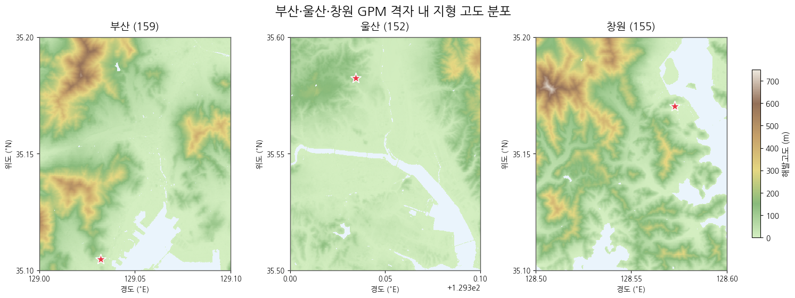

*그림 6.3.1. 부산(159), 울산(152), 창원(155) 관측지점이 포함된 GPM 격자의 DEM 지형 고도 분포. 붉은 별은 ASOS 관측소 위치이며, 색상은 해발고도(m)를 나타낸다. 각 지점의 지도는 같은 고도 색상 범위를 사용한다. 자료: Copernicus DEM GLO-30.*

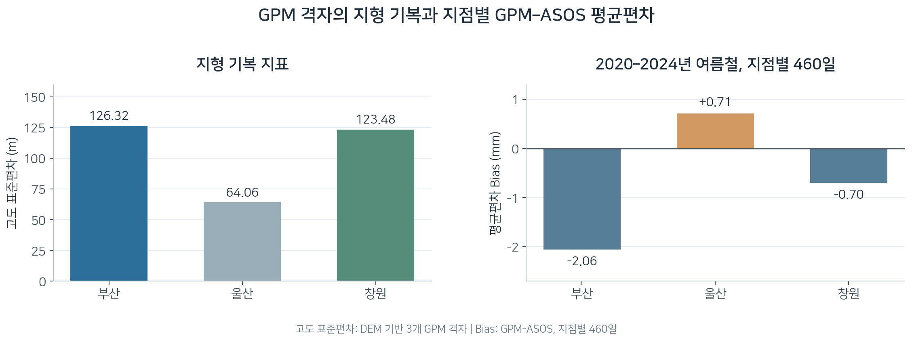

*그림 6.3.2. 부산·울산·창원 GPM 격자 내 고도 표준편차(m)와 2020~2024년 여름철 지점별 460일의 GPM–ASOS 평균편차(Bias, mm). 평균편차는 GPM−ASOS이며, 양수는 평균 과대추정, 음수는 평균 과소추정을 의미한다.*

### 6.3.3 격자 내부 강수 공간변동성 및 절대편차

공통 강수일 100일의 500m 격자 강수자료를 분석한 결과, 지점별 유효 육지 격자점은 부산 **366개**, 울산 **353개**, 창원 **332개**였다. 각 지점에서 동일한 격자점 위치를 100일 동안 사용했으며, 분석자료의 날짜·지점 조합은 총 300건이었다.

*표 6.3.2. 공통 강수일 100일의 지점별 강수 공간변동성과 GPM–ASOS 편차*

| 관측지점 | 500m 유효 격자점 수 | 평균 공간변동계수(%) | 고지대·저지대 강수량 평균 절대차(mm) | 100일 Bias(mm) | 100일 MAE(mm) |
|:---|---:|---:|---:|---:|---:|
| 부산 | 366 | 15.93 | 2.60 | -11.69 | 22.14 |
| 울산 | 353 | 13.88 | 1.60 | +1.66 | 14.36 |
| 창원 | 332 | 10.30 | 1.76 | -2.56 | 17.38 |

*주: 평균 공간변동계수는 날짜별 500m 육지 격자 강수량의 공간변동계수를 100일에 걸쳐 평균한 값이다. 고지대·저지대 강수량 평균 절대차는 날짜별 두 집단의 평균 강수량 차이를 절댓값으로 바꾼 뒤 평균한 값이다. 이 표의 Bias와 MAE는 표 6.3.1의 460일 통계와 다른 표본인 공통 강수일 100일 기준이다.*

100일 평균 강수 공간변동계수는 부산 **15.93%**, 울산 **13.88%**, 창원 **10.30%**로 나타났다. 고지대와 저지대의 평균 강수량 차이를 날짜별 절댓값으로 계산한 뒤 평균하면 부산 **2.60mm**, 울산 **1.60mm**, 창원 **1.76mm**였다. 같은 100일에서 GPM–ASOS 평균절대오차는 부산 **22.14mm**, 창원 **17.38mm**, 울산 **14.36mm** 순으로 나타났다. 지점별 강수 공간변동계수의 순위(부산 > 울산 > 창원)와 평균절대오차의 순위(부산 > 창원 > 울산)는 일치하지 않았다.

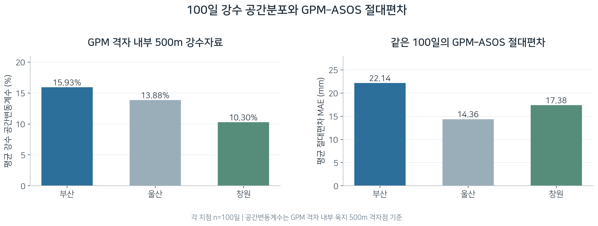

*그림 6.3.3. 선정된 공통 강수일 100일에서 산정한 지점별 평균 강수 공간변동계수(%)와 GPM–ASOS 평균절대오차(MAE, mm). 공간변동계수는 GPM 격자 내부 육지 500m 격자점의 강수량을 기준으로 계산하였다.*

### 6.3.4 강수 공간변동계수와 일강수량 절대편차의 상관관계

공통 강수일 100일에서 각 날짜의 강수 공간변동계수와 GPM–ASOS 일강수량 절대편차를 대응시켜 지점별 스피어만 순위상관계수(ρ)를 산정하였다.

*표 6.3.3. 강수 공간변동계수와 GPM–ASOS 일강수량 절대편차의 스피어만 상관계수*

| 관측지점 | 분석일수(n) | 스피어만 상관계수(ρ) |
|:---|---:|---:|
| 부산 | 100 | -0.160 |
| 울산 | 100 | -0.234 |
| 창원 | 100 | -0.233 |

상관계수는 부산 **−0.160**, 울산 **−0.234**, 창원 **−0.233**으로 모두 약한 음의 값을 보였다. 따라서 분석한 100일 자료에서는 강수 공간변동계수가 증가하는 날짜에 GPM–ASOS 절대편차도 함께 증가하는 양의 상관관계가 관찰되지 않았다.

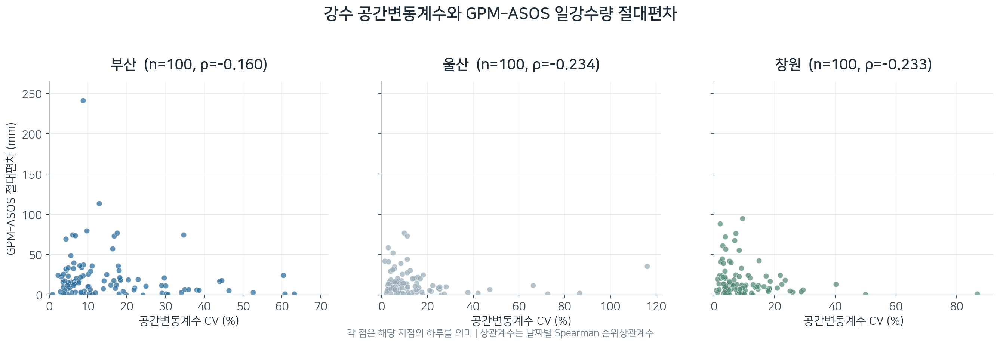

*그림 6.3.4. 공통 강수일 100일의 부산·울산·창원 지점별 강수 공간변동계수(가로축)와 GPM–ASOS 일강수량 절대편차(세로축)의 산점도. 점 하나는 해당 지점의 하루이며, 각 패널의 ρ는 스피어만 순위상관계수이다. 세 패널은 가로축 표시 범위가 서로 다르다.*

### 6.3.5 주요 결과 요약

부산과 창원의 GPM 격자는 울산보다 고도 표준편차와 고지대 면적 비율이 높게 나타났다. 같은 세 지점의 460일 평균편차는 부산·창원에서 음수, 울산에서 양수였으며, 평균절대오차는 부산 > 창원 > 울산 순이었다.

한편 선정된 공통 강수일 100일의 평균 강수 공간변동계수는 부산 > 울산 > 창원 순이었고, 해당 기간의 GPM–ASOS 평균절대오차는 부산 > 창원 > 울산 순으로 나타났다. 날짜별 공간변동계수와 일강수량 절대편차의 스피어만 상관계수는 세 지점 모두 약한 음의 값을 보여, **강수 공간변동성이 커질수록 절대편차가 함께 커지는 일관된 양의 관계는 확인되지 않았다.**

### 6.4 세부목적 4의 결과

### 6.4.1 연구 질문 및 분석 대상

**연구질문 4.** ASOS 관측 일강수량을 기준으로 강수 규모를 구분했을 때, GPM-IMERG와 ASOS 간의 편차는 강수 규모에 따라 어떠한 변화 양상을 보이며, 이러한 변화는 부산·울산·창원 관측지점별로 어떻게 다른가?

본 절에서는 2020~2024년 여름철(6~8월) 부산·울산·창원 3개 관측지점의 총 1,380개 지점·일 자료를 대상으로, ASOS 관측 일강수량의 네 구간별 표본 수, 평균편차(Bias), 평균절대오차(MAE), 평균제곱근오차(RMSE) 및 지점 전체 Bias에 대한 구간별 기여도를 제시하였다. 모든 결과는 세 지점에 각각 460일을 포함한 수정본 공통 마스터 자료에 근거한다. Bias의 양수는 GPM-IMERG 과대추정, 음수는 과소추정을 뜻한다.

### 6.4.2 강수 규모별 표본 분포

*표 6.4.1. ASOS 관측 강수 규모별 지점·일 표본 수*

| ASOS 관측 일강수량 구간 | 부산(n) | 울산(n) | 창원(n) | 전체(n) |
|:--|--:|--:|--:|--:|
| 0 mm | 276 | 282 | 270 | 828 |
| 0 mm 초과~10 mm 미만 | 95 | 98 | 96 | 289 |
| 10 mm 이상~30 mm 미만 | 37 | 43 | 44 | 124 |
| 30 mm 이상 | 52 | 37 | 50 | 139 |
| **합계** | **460** | **460** | **460** | **1,380** |

전체 1,380건 가운데 ASOS 관측 일강수량 0 mm에 해당하는 자료는 828건(60.0%)으로 가장 많았다. 30 mm 이상 구간의 표본 수는 부산 52건, 울산 37건, 창원 50건으로 지점별 차이가 있었다. 각 지점의 네 강수 구간 표본 수를 합산하면 모두 460건이다.

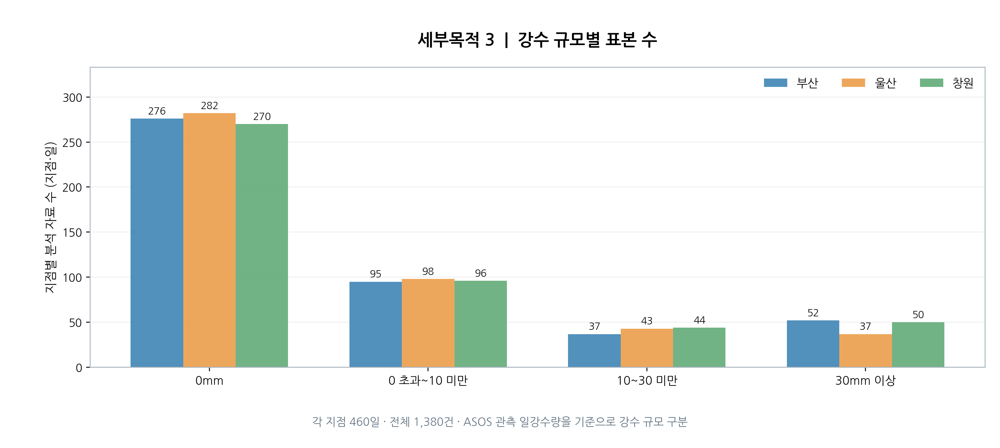

*그림 6.4.1. 2020~2024년 여름철 부산·울산·창원의 ASOS 관측 일강수량 구간별 지점·일 표본 수. 구간은 ASOS 정제 일강수량을 기준으로 하며, 각 지점의 총 표본 수는 460건이다.*

### 6.4.3 강수 규모별 평균편차(Bias)의 방향 및 크기

*표 6.4.2. ASOS 관측 강수 규모별 지점별 평균편차(Bias) 비교*

| ASOS 관측 일강수량 구간 | 부산 Bias(mm) | 울산 Bias(mm) | 창원 Bias(mm) |
|:--|--:|--:|--:|
| 0 mm | +0.63 | +0.87 | +0.71 |
| 0 mm 초과~10 mm 미만 | +3.43 | +2.74 | +3.62 |
| 10 mm 이상~30 mm 미만 | +1.46 | +1.89 | −3.92 |
| 30 mm 이상 | −28.83 | −7.25 | −13.77 |

ASOS 관측 일강수량이 0 mm인 구간에서 세 지점의 Bias는 모두 양수였으며, 부산 +0.63 mm, 울산 +0.87 mm, 창원 +0.71 mm로 나타났다. 0 mm 초과~10 mm 미만 구간에서도 부산 +3.43 mm, 울산 +2.74 mm, 창원 +3.62 mm로 세 지점 모두 평균적으로 GPM-IMERG 추정량이 ASOS 관측량보다 높았다.

10 mm 이상~30 mm 미만 구간에서는 부산(+1.46 mm)과 울산(+1.89 mm)의 Bias가 양수인 반면, 창원(−3.92 mm)은 음수로 나타나 지점별로 편차 방향이 달랐다. 30 mm 이상 구간에서는 부산 −28.83 mm, 울산 −7.25 mm, 창원 −13.77 mm로 세 지점 모두 음의 Bias를 보였으며, 음의 편차 크기는 부산에서 가장 컸다.

*그림 6.4.2. ASOS 관측 일강수량 네 구간에서 산정한 관측지점별 평균편차(Bias). 편차는 GPM-IMERG 추정 일강수량에서 ASOS 관측 일강수량을 뺀 값이며, 0 mm 기준선 위는 평균 과대추정, 아래는 평균 과소추정을 나타낸다.*

### 6.4.4 강수 규모별 MAE·RMSE 변화

세 지점 모두 ASOS 관측 강수 규모가 큰 구간일수록 MAE와 RMSE가 증가하는 양상을 보였다. 0 mm 구간에서 MAE는 부산 0.63 mm, 울산 0.87 mm, 창원 0.71 mm였으나, 0 mm 초과~10 mm 미만 구간에서는 각각 5.48 mm, 4.39 mm, 5.70 mm로 나타났다. 10 mm 이상~30 mm 미만 구간의 MAE는 부산 13.47 mm, 울산 11.82 mm, 창원 10.48 mm였다.

*표 6.4.3. 30 mm 이상 강수 구간의 관측지점별 MAE 및 RMSE 비교*

| 관측지점 | 30 mm 이상 구간 MAE(mm) | 30 mm 이상 구간 RMSE(mm) |
|:--|--:|--:|
| 부산 | 35.03 | 51.94 |
| 울산 | 22.90 | 29.63 |
| 창원 | 28.62 | 39.76 |

30 mm 이상 구간에서 MAE는 부산 35.03 mm, 울산 22.90 mm, 창원 28.62 mm였으며, RMSE는 각각 51.94 mm, 29.63 mm, 39.76 mm로 나타났다. 세 지점 모두 해당 구간에서 네 강수 구간 중 가장 큰 MAE와 RMSE를 보였고, 두 지표 모두 부산에서 가장 높았다. 모든 강수 구간에서 각 지점의 RMSE는 MAE보다 크게 나타났다.

*그림 6.4.3. ASOS 관측 일강수량 네 구간에서 산정한 부산·울산·창원의 MAE와 RMSE. 왼쪽은 MAE, 오른쪽은 RMSE이며 단위는 모두 mm이다.*

### 6.4.5 강수 규모별 전체 Bias 기여도

강수 구간별 편차가 각 지점의 전체 평균편차에 반영되는 정도를 비교한 결과는 다음과 같다.

*표 6.4.4. ASOS 관측 강수 규모별 관측지점 전체 Bias 기여도*

| ASOS 관측 일강수량 구간 | 부산 기여도(mm) | 울산 기여도(mm) | 창원 기여도(mm) |
|:--|--:|--:|--:|
| 0 mm | +0.38 | +0.53 | +0.42 |
| 0 mm 초과~10 mm 미만 | +0.71 | +0.58 | +0.76 |
| 10 mm 이상~30 mm 미만 | +0.12 | +0.18 | −0.38 |
| 30 mm 이상 | −3.26 | −0.58 | −1.50 |
| **지점별 전체 Bias** | **−2.06** | **+0.71** | **−0.70** |

*주: 기여도 및 전체 Bias는 각각 원자료의 정밀한 값을 이용해 계산한 뒤 소수점 둘째 자리로 반올림하여 표기하였다. 따라서 표에 표시된 기여도만 합산하면 전체 Bias와 0.01 mm 수준의 반올림 차이가 발생할 수 있다.*

부산에서는 30 mm 이상 구간의 전체 Bias 기여도가 −3.26 mm로, 나머지 세 구간의 양의 기여도 합계(약 +1.20 mm)보다 절댓값이 크게 나타났다. 그 결과 부산의 전체 Bias는 −2.06 mm였다. 창원 역시 30 mm 이상 구간의 기여도가 −1.50 mm였고, 나머지 구간의 기여도를 합산한 결과 전체 Bias는 −0.70 mm로 나타났다.

반면 울산의 30 mm 이상 구간 기여도는 −0.58 mm였으나, 나머지 세 구간의 양의 기여도 합계가 약 +1.29 mm로 나타나 전체 Bias는 +0.71 mm였다. 이처럼 강수 규모별 기여도를 구분한 결과, 세부목적 2에서 확인한 관측지점별 전체 Bias의 부호 차이가 어떤 강수 구간의 편차 합계와 연결되는지 확인할 수 있었다.

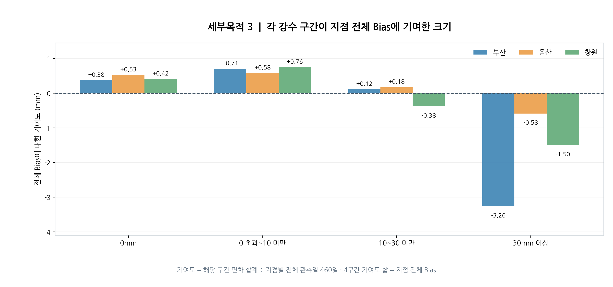

*그림 6.4.4. ASOS 관측 일강수량 구간별 편차가 지점별 전체 460일의 평균편차(Bias)에 기여한 값. 각 지점의 네 구간 기여도를 반올림 전 값으로 합산하면 해당 지점의 전체 Bias와 일치한다.*

### 6.4.6 주요 결과 요약

2020~2024년 여름철 부산·울산·창원 3개 지점에서 GPM-IMERG와 ASOS 일강수량의 평균편차는 강수 규모에 따라 방향과 크기가 달라졌다. 0 mm 초과~10 mm 미만 구간에서는 세 지점 모두 양의 Bias를, 30 mm 이상 구간에서는 모두 음의 Bias를 보였다. 10 mm 이상~30 mm 미만 구간의 Bias는 부산·울산에서 양수, 창원에서 음수로 나타나 지점별 차이가 확인되었다.

또한 세 지점 모두 30 mm 이상 구간에서 MAE와 RMSE가 가장 높았다. 강수 규모별 기여도에서는 부산·창원의 30 mm 이상 구간의 음의 기여가 전체 Bias를 음수로 만드는 데 크게 작용한 반면, 울산은 30 mm 미만 구간의 양의 기여가 더 크게 나타났다. 이러한 결과를 통해 강수 규모별 편차의 변화 양상과 관측지점 간 차이를 정량적으로 확인하였다.

  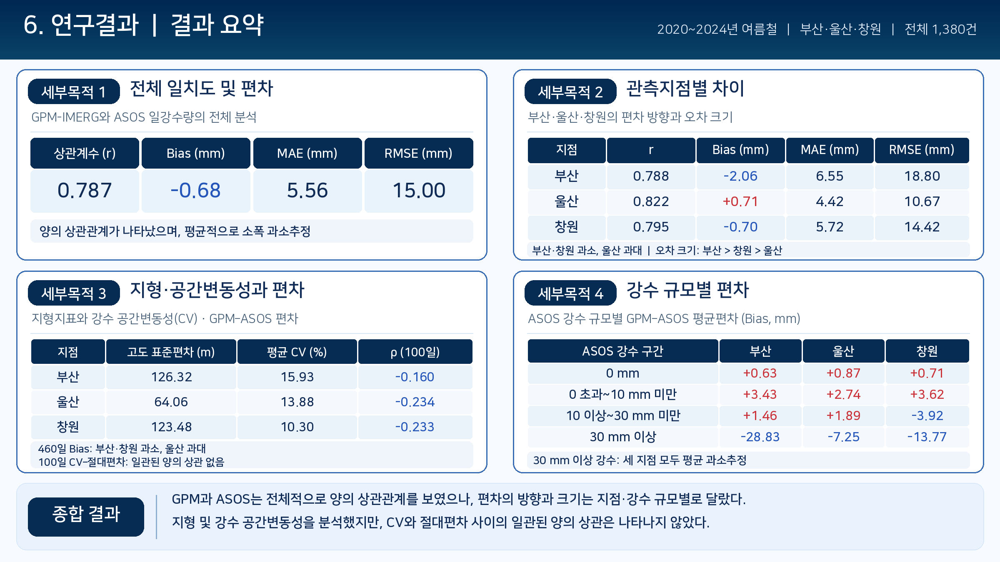

*그림 6.4.5. 2020~2024년 여름철 부산·울산·창원 3개 관측지점의 GPM-IMERG와 ASOS 일강수량 분석 결과 종합. 전체 일치도 및 편차(세부목적 1), 관측지점별 편차의 크기와 방향(세부목적 2), GPM 격자의 지형 기복 및 강수 공간변동성과 편차의 관련성(세부목적 3), 강수 규모별 편차 변화(세부목적 4)를 요약하였다.*

## 7. 토의 {#discussion}

*작성 예정*

## 8. 결론 {#conclusion}

*작성 예정*

---

### 부록 · 재현성 및 연구 기여 {#reproduce}

*작성 예정*

[섹션별 작성 지침]({{ site.github.repository_url }}/blob/main/05_보고서양식/섹션별_작성지침.md)
