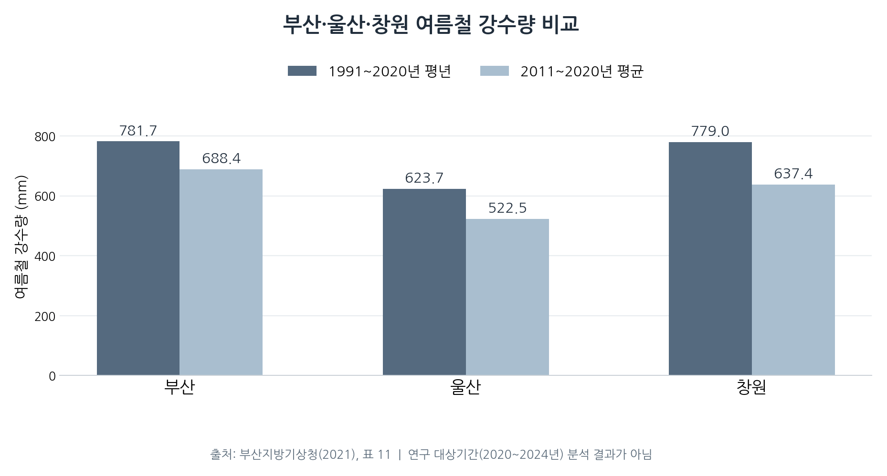

## 초록

*작성 예정 — 분석 후 실제 결과를 바탕으로 작성*

**주제어:** GPM-IMERG, ASOS, 일강수량, 지점별 편차, 강수 규모

## 1. 연구 배경 {#background}

### 1.1 여름철 강수정보의 중요성과 위성기반 강수자료의 활용 가치

강수량은 수자원 관리와 하천·배수시설 관리, 호우·침수 위험 검토 등에 활용되는 중요한 기초자료이다. 특히 우리나라의 여름철(6~8월)은 장마와 태풍, 국지성 호우 등의 영향을 받기 때문에 강수량의 시간적·공간적 분포를 파악하는 일이 중요하다. 따라서 **신뢰할 수 있는 강수정보를 확보하고, 그 특성과 한계를 올바르게 이해할 필요가 있다.**

부산지방기상청에 따르면 2024년 여름철 부산·울산·경남 주요 11개 관측지점의 평균 강수량은 574.9 mm였으며, 이 중 **452.9 mm(78.8%)가 장마철에 집중되었다**[[1]](#ref-1). 이 수치는 본 연구의 부산·울산·창원 세 지점만의 평균은 아니지만, 부울경 지역에서 여름철 강수정보를 체계적으로 파악할 필요가 있음을 보여주는 사례이다.

기상청 종관기상관측(ASOS)은 관측소가 설치된 특정 지점의 강수량을 측정하는 반면, 위성기반 강수자료는 넓은 지역에 걸친 강수 추정값을 일정한 공간 격자로 제공한다[[2]](#ref-2). NASA도 GPM 강수자료의 활용 분야로 수자원 관리, 재난·위험관리, 기상·기후 분석 등을 제시하고 있다[[3]](#ref-3). 본 연구에서 활용하는 GPM-IMERG는 여러 위성 관측정보를 결합하여 약 0.1°(약 11 km) 격자와 30분 간격으로 강수 추정값을 제공한다[[4]](#ref-4)[[5]](#ref-5). 이러한 특성은 지상 관측지점 사이의 강수 분포를 살펴보고 **지상 관측망을 공간적으로 보완하는 데 활용 가치를 갖는다**.

### 1.2 GPM-IMERG와 ASOS 간 편차 검토의 필요성

**ASOS와 GPM-IMERG는 강수량을 나타내는 공간적 범위와 산출 방식이 서로 다르다**. ASOS는 특정 관측지점에서 측정한 값인 반면, GPM-IMERG는 여러 위성 관측정보를 결합하여 격자 단위로 산출한 강수 추정값이다[[2]](#ref-2)[[4]](#ref-4). 따라서 동일한 날짜의 강수량을 비교하더라도 두 자료 사이에는 차이가 나타날 수 있다. 이러한 차이에는 공간적 대표 범위의 차이도 관련될 수 있으므로, 관측값과 추정값의 차이를 모두 위성자료 자체의 오류로 단정할 수는 없다. 또한 IMERG Final Run은 월 단위 지상 강수자료를 보정 과정에 활용하므로, 지상 관측자료와 완전히 독립적인 자료도 아니다[[4]](#ref-4)[[5]](#ref-5).

*그림 1. ASOS 지점 관측과 GPM-IMERG 격자 기반 강수 추정의 공간적 차이. 공간 단위의 차이를 설명하기 위한 모식도로, 실제 관측소 위치나 실제 강수 분포를 나타내지 않는다.*

두 자료의 산출 특성이 다르기 때문에 위성기반 강수자료를 지역 강수 분석에 활용하기 앞서 **지상 관측자료와의 일치도와 편차 수준을 점검해야 한다**. 선행연구에서도 강수 강도에 따라 IMERG의 평가 결과가 달라질 수 있음이 보고된 바 있으나[8], 이러한 특성은 대상 지역과 기간, 자료 버전에 따라 상이하게 나타나므로 부산·울산·창원 세 관측지점의 편차 방향이나 크기를 사전에 단정하기는 어렵다.

따라서 **지점별·강수 규모별 편차 특성을 검토하는 것**은 GPM-IMERG를 활용한 지역 강수 분석에서 **자료의 한계를 이해**하고, **결과를 해석할 때 주의해야 할 조건을 판단하기 위한 기초자료를 마련한다는 점**에서 필요하다. 구체적인 편차 경향과 유의 조건은 실제 분석 결과를 통해 확인해야 한다.

### 1.3 선행연구 검토 및 연구범위 선정 근거

GPM-IMERG와 지상 강수자료의 비교는 여러 선행연구에서 수행되었다. 이주원·이은희(2018)는 동아시아와 남한 지역에서 IMERG의 일강수량 추정 특성을 평가하였으며[[6]](#ref-6), 백종진 외(2018)는 국내 92개 ASOS 관측지점과 GPM 강수자료를 비교하고 지상 관측자료를 이용한 보정 기법을 검토하였다[[7]](#ref-7). 정임국 외(2024)는 2021~2022년 국내 ASOS 시간강수량을 기준으로 GPM-IMERG와 지상 레이더 강수자료의 추정 특성을 평가하였다[[8]](#ref-8).

이처럼 **선행연구들은 대상 지역과 기간, 시간 단위, 강수 조건에 따라 과대추정과 과소추정이 엇갈려 나타나므로 단일 연구 결과만으로 특정 지역의 편차 방향을 일반화하기 어렵다**. 이에 본 연구는 2020~2024년 부산·울산·창원 3개 관측지점의 **동일한 여름철 일강수량 기준 아래 지점별 편차 특성을 지점별·강수 규모별로 교차해 확인**한다는 분석 초점을 명확히 하고자 한다.

본 연구는 여름철 장마와 집중호우의 영향을 직접 받는 동남권 주요 생활권을 대상으로 위성 강수자료의 활용 가능성을 점검하고자, 권역 내 핵심 도시인 **부산·울산·창원을 비교 지점으로 선정하였다**. 세 도시는 동일한 동남권 기상 권역에 인접해 있으면서도 해안 인접성과 내륙 위치 등 관측 환경이 서로 달라, 같은 기간과 조건에서 지점별 위성 추정 편차의 차이를 대조하기에 적합하다. 다만 본 연구는 주변 지형이나 입지 요인이 편차에 미치는 인과적 영향을 규명하는 것이 아니라, 세 관측지점에서 나타나는 편차의 크기와 경향을 정량적으로 비교하는 데 초점을 둔다.

연구지역인 부산·울산·창원은 모두 부산·울산·경남 권역에 속하지만, **여름철 강수 특성이 동일하지는 않다**. 부산지방기상청(2021)의 자료에서 1991~2020년 여름철 평년 강수량은 부산 781.7 mm, 울산 623.7 mm, 창원 779.0 mm로 나타났다. 2011~2020년 여름철 평균 강수량 역시 부산 688.4 mm, 울산 522.5 mm, 창원 637.4 mm로 차이가 있었다[[9]](#ref-9).

*그림 2. 부산·울산·창원의 여름철 강수량 비교. 자료: 부산지방기상청(2021), 표 11. 제시된 기후통계는 본 연구 대상기간(2020~2024년)의 분석 결과가 아니다.*

같은 자료에서 2011~2020년 평균 여름철 호우일수(일강수량 80 mm 이상인 날의 수)는 부산 2.2일, 울산 1.2일, 창원 1.3일로 나타났다[[9]](#ref-9). 즉, 동일 권역에 속한 세 관측지점도 **누적 강수량과 강한 강수의 발생 빈도에서 차이를 보인다**.

*그림 3. 부산·울산·창원의 평균 여름철 호우일수 비교(2011~2020년, 일강수량 80 mm 이상 기준). 자료: 부산지방기상청(2021), 표 17. 본 연구 대상기간의 분석 결과는 아니다.*

이처럼 동일 권역에 속하면서도 여름철 강수량과 호우 발생 빈도가 서로 다른 세 지역을 동일한 기준으로 비교하면, **지점에 따라 위성 추정 편차의 크기나 방향이 달라지는지를 확인할 수 있다**. 다만 과거 기후통계상의 강수 차이가 곧 GPM-IMERG 편차의 차이를 미리 입증하는 것은 아니며, 세 지점의 분석 결과를 동남권 전체로 일반화할 수는 없다.

### 1.4 지점별·강수 규모별 편차 분석의 필요성과 연구 의의

GPM-IMERG를 지역 강수 분석에 활용하기 위해서는 먼저 동일 관측일의 ASOS 지상 관측값과 **전반적으로 어느 수준의 일치도와 편차를 보이는지** 기준을 확인할 필요가 있다.

그러나 **전체적인 일치도와 편차만으로는 개별 관측지점의 추정 특성을 충분히 설명하기 어렵다**. 예를 들어 한 지점에서 과대추정, 다른 지점에서 과소추정이 나타난다면 전체 평균에서는 이러한 차이가 상쇄될 수 있다. 따라서 지점별 일치도와 편차의 크기뿐 아니라 **과대·과소추정 경향을 따로 살펴보아야**, 전체 결과가 가릴 수 있는 개별 지점의 특성을 확인할 수 있다. 이는 가능한 상황을 설명한 예시이며 실제 결과를 미리 단정하는 것은 아니다.

또한 **지점별로 산정한 평균적인 편차만으로는 강수 규모에 따라 추정 특성이 달라지는지 알기 어렵다**. 같은 지점이라도 약한 강수와 강한 강수에서 편차의 크기나 방향이 달라질 수 있으므로, **ASOS 관측 강수 규모에 따라 편차가 어떻게 변화하는지**를 각 지점에서 구분해 확인할 필요가 있다. 그래야 지점별 전체 결과에 가려질 수 있는 강수 조건별 특성을 파악할 수 있다.

이처럼 **전반적인 비교에서 지점별 비교로, 다시 강수 규모에 따른 지점별 비교로 확장하는 과정**은 분석 항목을 단순히 나열하는 것이 아니라, 앞 단계의 결과만으로 설명하기 어려운 부분을 추가로 확인하는 과정이다. 궁극적으로 본 연구는 이러한 결과를 종합하여 **GPM-IMERG로 지역의 여름철 일강수량을 분석할 때 어떤 지점과 강수 조건에서 편차를 고려해야 하는지 판단할 근거**를 마련하고자 한다. 구체적인 활용상 유의사항은 실제 연구결과를 바탕으로 제시한다.

### 연구배경 참고문헌

[1] 부산지방기상청(2024.09.05), 「2024년 여름철(6~8월) 부울경 기후특성」. [원문](https://www.weather.go.kr/busan/html/news/notice_view.jsp?articleno=12662&boardId=press2&pageNo=1)

[2] 기상청 기상자료개방포털, 「종관기상관측(ASOS) 자료 및 지점정보」. [원문](https://data.kma.go.kr/data/grnd/selectAsosRltmList.do)

[3] NASA, *How is GPM data used in real-world applications?* [원문](https://gpm.nasa.gov/resources/faq/how-gpm-data-used-real-world-applications)

[4] NASA(2023), *IMERG V07 Technical Documentation*. [원문](https://gpm.nasa.gov/resources/documents/imerg-v07-technical-documentation)

[5] Google Earth Engine Data Catalog, *NASA/GPM_L3/IMERG_V07*. [원문](https://developers.google.com/earth-engine/datasets/catalog/NASA_GPM_L3_IMERG_V07)

[6] 이주원·이은희(2018), 「동아시아 및 남한 지역에서의 Integrated MultisatellitE Retrievals for GPM (IMERG) 일강수량의 지상관측 검증」, 『대기』, 28(3), 273–289. [원문](https://doi.org/10.14191/Atmos.2018.28.3.273)

[7] 백종진 외(2018), 「GPM 위성 강우자료의 검증과 지상관측 자료를 통한 강우 보정 기법」, 『한국수자원학회논문집』, 51(2). [원문](https://doi.org/10.3741/JKWRA.2018.51.2.131)

[8] 정임국 외(2024), *Accuracy Assessment of Precipitation Products from GPM IMERG and CAPPI Ground Radar over South Korea*, 『대한원격탐사학회지』, 40(3), 269–274. [원문](https://doi.org/10.7780/kjrs.2024.40.3.3)

[9] 부산지방기상청(2021.06.09), 「신평년(1991~2020년) 대비 최근 10년(2011~2020년) 여름철 부울경 기후특성」, 표 11·17. [보도자료 및 PDF](https://www.kma.go.kr/busan/html/news/notice_view.jsp?articleno=11651&boardId=press2&pageNo=1)

## 2. 연구 질문 {#question}

*작성 예정*

## 3. 연구 목적 {#objectives}

*작성 예정*

## 4. 재료 {#materials}

*작성 예정*

## 5. 방법 {#method}

*작성 예정*

## 6. 결과 {#results}

*작성 예정*

## 7. 토의 {#discussion}

*작성 예정*

## 8. 결론 {#conclusion}

*작성 예정*

---

### 부록 · 재현성 및 연구 기여 {#reproduce}

*작성 예정*

[섹션별 작성 지침]({{ site.github.repository_url }}/blob/main/05_보고서양식/섹션별_작성지침.md)
