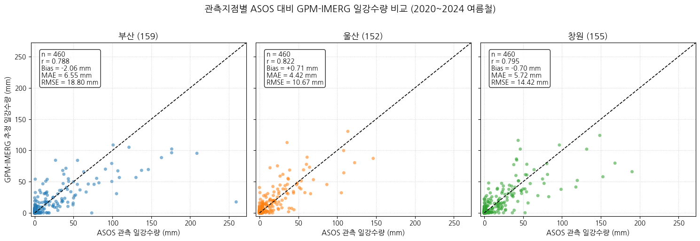
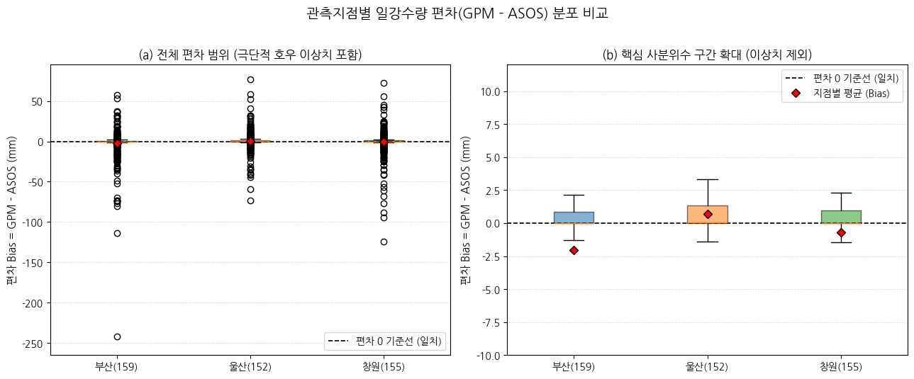
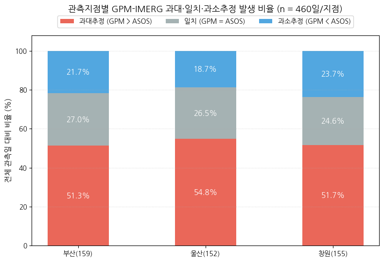
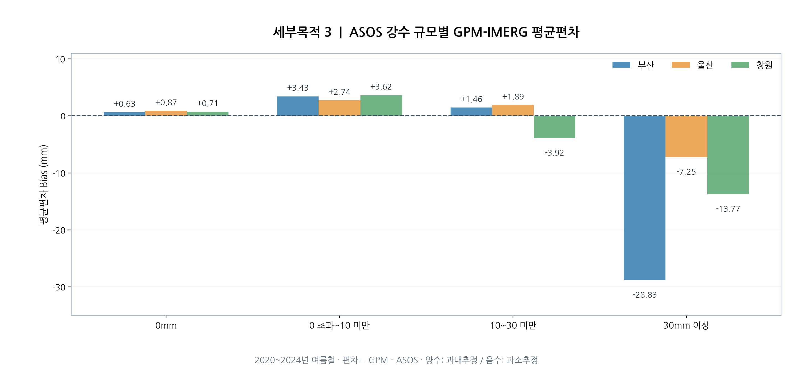
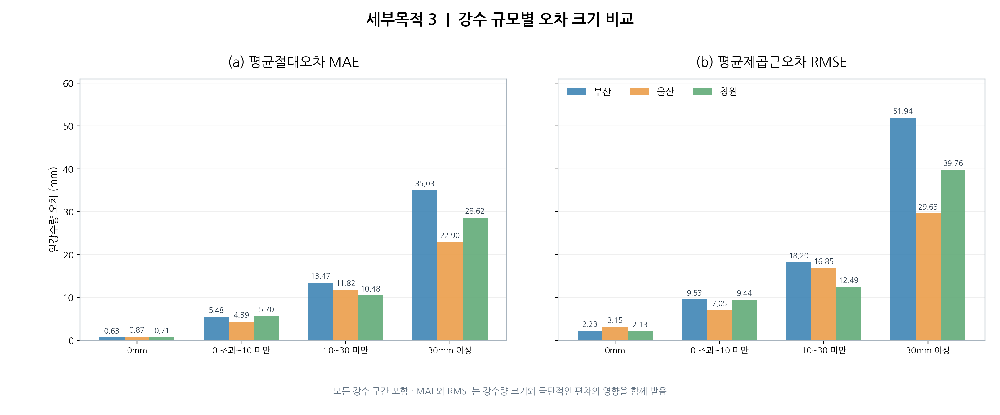

## 초록

*작성 예정 — 분석 후 실제 결과를 바탕으로 작성*

**주제어:** GPM-IMERG, ASOS, 일강수량, 지점별 편차, 강수 규모

## 1. 연구 배경 {#background}

### 1.1 여름철 강수정보의 중요성과 위성기반 강수자료의 활용 가치

우리나라의 여름철(6-8월)은 장마와 태풍의 영향으로 연 강수량의 과반이 집중되는 시기이며, 기후변화로 인해 시공간적 예측이 어려운 국지성 집중호우가 빈발하고 있다. 더하여, 본 연구의 대상지인 부산, 울산, 창원을 아우르는 동남권은 복잡한 해안 지형과 고밀도 도심이 결합되어 있어, 짧은 시간의 집중 호우만으로도 도심지 지하차도 침수, 하천 범람, 산사태 등 치명적인 대형 재난으로 직결될 위험이 크다.
이러한 국지성 집중호우와 반대되는 극한 가뭄 상황에서도 강수량 모니터링은 필수적이다. 우리나라는 6-9월에 강수가 집중되고 대부분이 바다로 빠르게 유출되어 수자원 유지 관리가 지형적으로 불리하다.[[9]](#ref-9) 강수 부족이 저수 부족으로 이어져 농작물 피해나 강수량 변동에 직접적인 영향을 받는 수력발전[[12]](#ref-12) 등 에너지 분야에 이르기까지 강수는 그 자체로 다양한 분야와 얽혀있다. 구체적인 사례는 다음과 같다.

| 구분 | 발생 시기 및 지역 | 주요 피해 및 현황 | 출처 |
| :--- | :--- | :--- | :---: |
| **집중호우** (도시침수) | 2020년 7월 부산 | 시간당 80 mm 이상 집중호우와 만조가 겹쳐 초량 제1지하차도 침수(사망 3명) 및 수백 건 침수 피해 발생 | <a href="#ref-1">[1]</a><a href="#ref-2">[2]</a> |
| **집중호우** (댐 방류) | 2020년 8월 경남 합천·남강댐 | 계획홍수위 도달에 따른 대량 방류로 주택·농경지 침수 및 가축 폐사 등 약 3,700억 원 규모 경제적 손실 발생 | <a href="#ref-3">[3]</a><a href="#ref-4">[4]</a> <a href="#ref-5">[5]</a><a href="#ref-6">[6]</a> |
| **극한 호우** | 2024년 9월 부산·창원 | 일 누적 수백 mm에 달하는 극한 강수로 대규모 주민 대피 및 도심 침수 사태 발생 | <a href="#ref-7">[7]</a><a href="#ref-8">[8]</a> |
| **극심한 가뭄** | 2026년 여름 경남 전역 | 평년 대비 절반 이하 저수율(33.3%) 기록 및 1,900 ha 이상 농작물 가뭄 피해 발생 | <a href="#ref-10">[10]</a> |

즉 여러 재해를 방지하고 발생할 수 있는 사회적, 경제적, 기술적 문제를 막기 위해 **정확한 강우정보 파악은 필요하다**. 

강우정보 산정시 활용할 위성 자료의 특성을 기상청에서 주로 사용하는 지상 관측 자료와 비교해보자면, 지상 우량계(ASOS)는 지점 간 공간 공백이 존재하고, 지상 기상레이터는 산악 지형 차폐나 관측 반경의 제약을 받는 반면, GPM-IMERG는 다중 위성 관측을 융합하여 약0.1°(약 11 km) 격자와 30분 간격의 연속적인 공간 강수 정보를 제공하므로 지상 관측망의 공간적 한계를 보완하는 핵심 도구로서 활용하고자 한다[[13]](#ref-13)[[15]](#ref-15)[[16]](#ref-16). 이러한 개인적 추론뿐만 아니라 NASA에서 GPM 강수자료의 활용 분야로 수자원 관리, 재난·위험관리, 기상·기후 분석 등을 제시하고 있다는 점 또한 본 연구에 해당 tool을 활용함에 있어 적합하단 근거로 작용했다[[14]](#ref-14).  

### 1.2 GPM-IMERG와 ASOS 간 편차 검토의 필요성

**위 관측 방식을 활용하기에 앞서 각 관측값은 강수량을 나타내는 공간적 범위와 산출 방식이 서로 다르다는 점을 고려해야 한다**. ASOS는 특정 관측지점에서 측정한 값인 반면, GPM-IMERG는 여러 위성 관측정보를 결합하여 격자 단위로 산출한 강수 추정값이다[[13]](#ref-13)[[15]](#ref-15). 따라서 동일한 날짜의 강수량을 비교하더라도 두 자료 사이에는 차이가 나타날 수 있다. 이러한 차이에는 공간적 대표 범위의 차이도 관련될 수 있으므로, 관측값과 추정값의 차이를 모두 위성자료 자체의 오류로 단정할 수는 없다. 또한 IMERG Final Run은 월 단위 지상 강수자료를 보정 과정에 활용하므로, 지상 관측자료와 완전히 독립적인 자료도 아니다[[15]](#ref-15)[[16]](#ref-16).

*그림 1. ASOS 지점 관측과 GPM-IMERG 격자 기반 강수 추정의 공간적 차이. 공간 단위의 차이를 설명하기 위한 모식도로, 실제 관측소 위치나 실제 강수 분포를 나타내지 않는다.*

두 자료의 산출 특성이 다르기 때문에 위성기반 강수자료를 지역 강수 분석에 활용하기 앞서 **지상 관측자료와의 일치도와 편차 수준을 점검해야 한다**. 선행연구에서도 강수 강도에 따라 IMERG의 평가 결과가 달라질 수 있음이 보고된 바 있으나[[19]](#ref-19), 이러한 특성은 대상 지역과 기간, 자료 버전에 따라 상이하게 나타나므로 부산·울산·창원 세 관측지점의 편차 방향이나 크기를 사전에 단정하기는 어렵다.

따라서 **지점별·강수 규모별 편차 특성을 검토하는 것**은 GPM-IMERG를 활용한 지역 강수 분석에서 **자료의 한계를 이해**하고, **결과를 해석할 때 주의해야 할 조건을 판단하기 위한 기초자료를 마련한다는 점**에서 필요하다. 구체적인 편차 경향과 유의 조건은 실제 분석 결과를 통해 확인해야 한다.

### 1.3 선행연구 검토 및 연구범위 선정 근거

GPM-IMERG와 지상 강수자료의 비교는 여러 선행연구에서 수행되었다. 이주원·이은희(2018)는 동아시아와 남한 지역에서 IMERG의 일강수량 추정 특성을 평가하였으며[[17]](#ref-17), 백종진 외(2018)는 국내 92개 ASOS 관측지점과 GPM 강수자료를 비교하고 지상 관측자료를 이용한 보정 기법을 검토하였다[[18]](#ref-18). 정임국 외(2024)는 2021~2022년 국내 ASOS 시간강수량을 기준으로 GPM-IMERG와 지상 레이더 강수자료의 추정 특성을 평가하였다[[19]](#ref-19).

이처럼 **선행연구들은 대상 지역과 기간, 시간 단위, 강수 조건에 따라 과대추정과 과소추정이 엇갈려 나타나므로 단일 연구 결과만으로 특정 지역의 편차 방향을 일반화하기 어렵다**. 이에 본 연구는 관측 대상 지점의 **동일한 여름철 일강수량 기준에서 지점별·강수 규모별 편차 특성을 함께 확인**한다는 분석 초점을 명확히 하고자 한다.

그 중, 본 연구는 **부산·울산·창원을 관측 비교 대상 지점으로 선정하였다**. 선정 배경은 여름철 장마와 집중호우의 영향을 직접 받는 동남권 주요 생활권을 대상으로, 위성 강수자료의 활용 가능성을 점검하고자 동일한 동남권 기상 권역에 인접해 있으면서도 해안 인접성과 내륙 위치 등 관측 환경이 서로 달라, 같은 기간과 조건에서 지점별 위성 추정 편차의 차이를 대조하기에 적합하기 때문이다. 다만 본 연구는 주변 지형이나 입지 요인이 편차에 미치는 인과적 영향을 규명하는 것이 아니라, 세 관측지점에서 나타나는 편차의 크기와 경향을 정량적으로 비교하는 데 초점을 둔다.

연구지역인 부산·울산·창원은 모두 부산·울산·경남 권역에 속하지만, **여름철 강수 특성이 동일하지는 않다**. 부산지방기상청(2021)의 자료에서 1991-2020년 여름철 평년 강수량은 부산 781.7 mm, 울산 623.7 mm, 창원 779.0 mm로 나타났다. 2011-2020년 여름철 평균 강수량 역시 부산 688.4 mm, 울산 522.5 mm, 창원 637.4 mm로 차이가 있었다[[20]](#ref-20).

*그림 2. 부산·울산·창원의 여름철 강수량 비교. 자료: 부산지방기상청(2021), 표 11. 제시된 기후통계는 본 연구 대상기간(2020~2024년)의 분석 결과가 아니다.*

같은 자료에서 2011~2020년 평균 여름철 호우일수(일강수량 80 mm 이상인 날의 수)는 부산 2.2일, 울산 1.2일, 창원 1.3일로 나타났다[[20]](#ref-20). 즉, 동일 권역에 속한 세 관측지점도 **누적 강수량과 강한 강수의 발생 빈도에서 차이를 보인다**.

*그림 3. 부산·울산·창원의 평균 여름철 호우일수 비교(2011~2020년, 일강수량 80 mm 이상 기준). 자료: 부산지방기상청(2021), 표 17. 본 연구 대상기간의 분석 결과는 아니다.*

이처럼 동일 권역에 속하면서도 여름철 강수량과 호우 발생 빈도가 서로 다른 세 지역을 동일한 기준으로 비교하면, **지점에 따라 위성 추정 편차의 크기나 방향이 달라지는지를 확인할 수 있다**. 다만 과거 기후통계상의 강수 차이가 곧 GPM-IMERG 편차의 차이를 미리 입증하는 것은 아니며, 세 지점의 분석 결과를 동남권 전체로 일반화할 수는 없다.

### 1.4 주제 선정시 기준이 된 연구 질문과 세부목적별 필요성

위 내용을 종합하면 본 연구의 본질적 질문은 다음과 같다.
**GPM-IMERG와 ASOS의 일강수량 편차는 부산·울산·창원 지점별로, 그리고 ASOS 관측 강수 규모별로 어떻게 달라지는가?**

**세부목적 1. 두 자료의 일치도와 편차 산정.** 위성 강수자료를 활용할 수 있는지 판단하려면 먼저 기상 관측값과의 전반적인 일치도와 편차를 파악해 **이후의 비교 기준을 세워야 한다**.
**세부목적 2. 관측지점별 일치도 및 편차 크기와 과대·과소추정 경향 도출.** 전체적인 일치도와 편차만으로는 개별 관측지점의 추정 특성을 충분히 설명하기 어렵다. 예를 들어 한 지점에서 과대추정, 다른 지점에서 과소추정이 나타난다면 전체 평균에서는 이러한 차이가 상쇄될 수 있다. 따라서 **지점별 일치도와 편차의 크기뿐 아니라 과대·과소추정 경향을 따로 살펴보아야**, 전체 결과가 가릴 수 있는 개별 지점의 특성을 확인할 수 있다. 이는 가능한 상황을 설명한 예시이며 실제 결과를 미리 단정하지 않는다.

**세부목적 3. 강수 규모별 편차의 지점별 변화 양상 도출.** 약한 비와 강한 비에서 추정 편차가 다르게 나타날 수 있어, 지점 평균만으로는 드러나지 않는 **규모별 변화를 각 지점에서 확인할 필요가 있다**.

### 1.5 본 연구의 의의 및 해석 범위

본 연구는 동일한 여름철 일강수량 기준 아래 부산·울산·창원 세 관측지점의 GPM-IMERG 추정 편차를 지점별·강수 규모별로 교차 검증함으로써, 동남권 강수 분석에서 위성 강수자료를 활용할 때 유의해야 할 지점 및 강수 조건별 오차 특성을 정량적으로 제시하는 데 의의가 있다. 다만 본 분석은 2020-2024년 여름철(6-8월) 3개 관측지점을 대상으로 수행되었으므로, 도출된 편차 경향은 동남권 여름철 조건에 한정하여 해석해야 하는 한계가 있으며 다른 계절이나 전국 단위의 일반적인 특성으로 확대 적용할 수는 없다.또한 강수 해석에 필요한 편차 특성을 제시하는 것에 그치며, 홍수 예측 성능이나 재난 피해 감소를 직접 입증하지 않는다.

### 연구배경 참고문헌

[1] 노컷뉴스, 부산 물폭탄에 피해 속출(2020.7.24). [원문](https://www.nocutnews.co.kr/news/5383874)

[2] 이투데이, 시간당 80mm 물폭탄 쏟아진 부산(2020.7.24). [원문](https://www.etoday.co.kr/news/view/1921777)

[3] 서울신문, 환경부 2020년 8월 댐 하류 수해 원인조사 발표(2021.8.4). [원문](https://m.go.seoul.co.kr/news/2021/08/04/20210804009016)

[4] 트윅, 합천군 합천댐 수위조절 실패 주장(2020.8.10). [원문](https://www.twig24.com/news/local_gs/kynam_gs/2020/08/10/20200810500173)

[5] 한국법률일보, 2020년 8월 홍수 피해 17개 시·군 배상(2022.3.22). [원문](https://www.lawfact.co.kr/news_proc/news_contents.jsp?ncd=2821)

[6] 한국수자원공사, 2021 지역문제해결 자료. [원문](https://www.kwater.or.kr/danbitoktok/down/localsolving/2021_localProblemSolving_01.pdf)

[7] 뉴시스, 426mm 물폭탄 부산(2024.9.22). [원문](https://www.newsis.com/view/NISX20240922_0002894352)

[8] 세계일보, 창원 529mm(2024.9.22). [원문](https://www.segye.com/newsView/20240922509294)

[9] 대한토목학회 학술발표(2017), 수자원 이용현황과 강우 집중. [원문](https://koreascience.kr/article/CFKO201732863556270.pdf)

[10] 노컷뉴스, 쩍쩍 갈라진 저수지, 짙어진 녹조…경남. [원문](https://nocutnews.co.kr/news/6561251)

[11] 김덕환 외(2023), 관개회귀수량 산정방법론, 한국수자원학회 학술발표회. [원문](https://koreascience.or.kr/article/CFKO202323654233246.pdf)

[12] 수력발전 비중(KOSIS 2023 인용), 한국방재학회 등. [원문](https://koreascience.kr/article/JAKO202423957696572.pdf)

[13] 기상청 기상자료개방포털, 「종관기상관측(ASOS)자료 및 지점정보」. [원문](https://data.kma.go.kr/data/grnd/selectAsosRltmList.do)

[14] NASA, How is GPM data used in real-world application?. [원문](https://gpm.nasa.gov/resources/faq/how-gpm-data-used-real-world-applications)

[15] NASA(2023), *IMERG V07 Technical Documentation*. [원문](https://gpm.nasa.gov/resources/documents/imerg-v07-technical-documentation)

[16] Google Earth Engine Data Catalog, *NASA/GPM_L3/IMERG_V07*. [원문](https://developers.google.com/earth-engine/datasets/catalog/NASA_GPM_L3_IMERG_V07)

[17] 이주원·이은희(2018), 「동아시아 및 남한 지역에서의 Integrated MultisatellitE Retrievals for GPM (IMERG) 일강수량의 지상관측 검증」, 『대기』, 28(3), 273–289. [원문](https://doi.org/10.14191/Atmos.2018.28.3.273)

[18] 백종진 외(2018), 「GPM 위성 강우자료의 검증과 지상관측 자료를 통한 강우 보정 기법」, 『한국수자원학회논문집』, 51(2). [원문](https://doi.org/10.3741/JKWRA.2018.51.2.131)

[19] 정임국 외(2024), *Accuracy Assessment of Precipitation Products from GPM IMERG and CAPPI Ground Radar over South Korea*, 『대한원격탐사학회지』, 40(3), 269–274. [원문](https://doi.org/10.7780/kjrs.2024.40.3.3)

[20] 부산지방기상청(2021.06.09), 「신평년(1991-2020년) 대비 최근 10년(2011-2020년) 여름철 부울경 기후특성」, 표 11·17. [보도자료 및 PDF](https://www.kma.go.kr/busan/html/news/notice_view.jsp?articleno=11651&boardId=press2&pageNo=1)

## 2. 연구 질문 {#question}

앞서 제시한 강수정보의 사회적·경제적 활용 가치와 GPM-IMERG 및 ASOS 간 편차 검토의 필요성을 바탕으로, 본 연구에서 확인하고자 하는 내용을 세 가지 연구질문으로 구체화하였다. 각 연구질문은 문제의식을 나타내는 일상적 질문과 분석 대상 및 비교 조건을 명시한 학술적 연구질문으로 구성하였으며, 연구질문 1~3은 다음 절의 세부목적 1~3에 각각 대응한다.

### 2.1 연구 질문 1

- **일상적 질문:** “위성으로 측정한 강수량은 실제 지상에서 관측한 강수량과 얼마나 비슷할까?”
- **학술적 연구 질문:** 2020~2024년 여름철 부산·울산·창원 3개 관측지점에서 GPM-IMERG 추정 일강수량과 ASOS 관측 일강수량 간의 전반적인 일치도와 편차는 어느 정도인가?

### 2.2 연구 질문 2

- **일상적 질문:** "같은 위성자료를 사용하더라도 지역에 따라 실제 강수량과의 차이가 다르게 나타날까?"
- **학술적 연구 질문:** 2020~2024년 여름철 부산·울산·창원 3개 관측지점에서 GPM-IMERG와 ASOS 일강수량 간의 일치도 및 편차 크기와 과대·과소추정 경향은 지점별로 어떠한 차이를 보이는가?

### 2.3 연구 질문 3

- **일상적 질문:** "위성은 약한 비와 강한 비를 비슷한 수준으로 추정할까? 지역에 따라서도 그 차이가 달라질까?"
- **학술적 연구 질문:** ASOS 관측 일강수량을 기준으로 강수 규모를 구분했을 때, GPM-IMERG와 ASOS 간의 편차는 강수 규모에 따라 어떠한 변화 양상을 보이며, 이러한 변화는 부산·울산·창원 관측지점별로 어떻게 다른가?

## 3. 연구 목적 {#objectives}

*그림 4. 연구질문과 세부연구목적의 대응 관계 및 전체 연구 구성. 전반적인 일치도와 편차 산정(세부목적 1)을 시작으로 관측지점별 편차 특성 비교(세부목적 2), 강수 규모에 따른 지점별 편차 변화 분석(세부목적 3)으로 연구를 구체화한 흐름을 나타낸다.*

### 3.1 전체 연구 목적

본 연구는 2020~2024년 여름철(6~8월) 부산·울산·창원 3개 관측지점에서 GPM-IMERG 위성 추정 일강수량과 ASOS 지상 관측 일강수량(무강수일 포함)을 비교하여, 두 자료 간의 전반적인 일치도와 편차를 정량적으로 분석하는 것을 목적으로 한다. 특히 관측지점과 ASOS 관측 강수 규모에 따른 편차의 크기와 방향을 비교하고, 과대·과소추정 경향 및 편차의 변화 양상을 파악하여 GPM-IMERG 자료를 활용할 때 고려해야 할 사항을 도출하고자 한다.

본 연구는 새로운 강수자료 보정 기법을 개발하거나 강수 규모가 편차를 발생시키는 원인을 규명하는 것을 목적으로 하지 않는다. 관측된 편차를 바탕으로 자료 간 차이와 변화 양상을 분석하는 데 초점을 둔다. 또한 부산·울산·창원 3개 지점의 5개 여름철 자료를 대상으로 하므로 연구 결과의 해석 범위를 동남권 여름철로 한정하며, 전국이나 다른 계절로 일반화하지 않는다. 홍수 예측 성능이나 재난 피해 감소 효과를 직접 검증하는 것 역시 연구 범위에 포함하지 않는다.

이러한 연구 목적을 달성하기 위해 세부목적을 세 단계로 구성하였다. 먼저 두 자료 간의 전반적인 일치도와 편차를 산정하여 이후 비교의 기준을 마련한다(세부목적 1). 다음으로 관측지점별 일치도와 편차의 크기 및 방향을 비교하여 전체 결과만으로는 구분하기 어려운 지점 간 차이를 확인한다(세부목적 2). 마지막으로 각 관측지점에서 강수 규모에 따른 편차의 변화 양상을 분석하여 지점별·강수 규모별 차이를 파악한다(세부목적 3). 이를 통해 전반적인 자료 간 차이 파악 → 관측지점별 편차 비교 → 강수 규모에 따른 지점별 편차 변화 분석의 순서로 연구를 진행한다.

### 3.2 세부목적 1

**동일 관측일의 GPM-IMERG 추정 일강수량과 ASOS 관측 일강수량 간 일치도 및 편차 산정**

**연구 질문 1의 목적화.** 동일 관측일의 GPM-IMERG 추정 일강수량과 ASOS 관측 일강수량을 비교하여 두 자료 간의 전반적인 일치도와 편차를 산정한다.

**필요성 및 평가 지표.** 위성 강수자료를 활용할 때 지상 관측자료와 어느 정도 일치하는지 먼저 파악할 필요가 있다. 이를 통해 두 자료 간 전반적인 차이를 확인하고, 이후 관측지점 및 강수 규모별 비교를 위한 기준을 마련한다. 구체적으로는 두 자료 간 상관계수(r), 평균편차(Bias), 평균절대오차(MAE), 평균제곱근오차(RMSE)를 산출하여 전반적인 일치도와 오차 크기를 평가한다.

### 3.3 세부목적 2

**관측지점별 GPM-IMERG와 ASOS 일강수량 간의 일치도·편차 크기 산정 및 GPM-IMERG의 과대·과소추정 경향 도출**

**연구 질문 2의 목적화.** 부산·울산·창원 각 관측지점에서 두 자료 간의 일치도와 편차의 크기 및 방향을 비교하여 관측지점에 따른 차이를 파악한다.

**필요성 및 평가 지표.** 전체 자료를 통합한 결과만으로는 관측지점별 편차의 차이를 구분하기 어렵다. 

 
*그림 5. 전체 평균편차에서 관측지점별 과대·과소추정이 상쇄될 수 있음을 설명하는 개념도. 표시된 부산 +5mm, 울산 −5mm, 창원 0mm는 실제 연구 결과가 아닌 설명을 위한 가상의 예시이다.*

또한 GPM-IMERG는 격자 단위의 강수 추정자료이므로 관측지점의 지리적 환경과 강수의 공간적 분포에 따라 지상 관측값과의 편차가 다르게 나타날 가능성이 있다. 따라서 지점별 비교를 통해 과대·과소추정 경향과 편차 크기의 차이를 확인할 필요가 있다. 이를 위해 관측지점별 상관계수(r), 평균편차(Bias)의 부호 및 크기, MAE, RMSE와 과대·과소추정 발생 일수 비율을 비교하여 지점 간 추정 경향의 차이를 평가한다.

### 3.4 세부목적 3

**ASOS 관측 강수 규모에 따른 GPM-IMERG 추정 강수량 편차의 지점별 변화 양상 도출**

**연구 질문 3의 목적화.** ASOS 관측 일강수량을 기준으로 강수 규모를 구분하고, 각 관측지점에서 강수 규모에 따른 GPM-IMERG와 ASOS 간 편차의 크기와 방향을 비교하여 그 변화 양상을 분석한다.

**필요성 및 평가 지표.** 약한 강수와 강한 강수에서 편차의 크기와 방향이 다르게 나타날 가능성이 있으므로, 각 관측지점에서 강수 규모별 편차를 비교할 필요가 있다. 본 연구에서는 ASOS 관측 일강수량을 기준으로 0mm, 0mm 초과~10mm 미만, 10mm 이상~30mm 미만, 30mm 이상의 네 구간으로 구분하였다. 이를 바탕으로 강수 규모 구간별 표본 수, 평균편차(Bias), MAE, RMSE의 변화 양상을 비교하여 강수 규모에 따른 편차 특성을 평가한다.

## 4. 재료 {#materials}

*작성 예정*

## 5. 방법 {#method}

### 5.4 세부목적 3 — ASOS 관측 강수 규모별 GPM-IMERG 편차 산정 및 지점별 변화 양상 비교

#### 5.4.1 ASOS 관측 일강수량에 따른 강수 규모 구분

세부목적 3에서는 지상에서 관측된 강수 규모에 따라 GPM-IMERG 추정 일강수량의 편차가 어떻게 달라지는지 확인하기 위해 ASOS 관측 일강수량을 기준으로 강수 구간을 구분하였다. 위성 추정값이 아닌 ASOS 관측값을 기준으로 사용한 것은 지상에서 관측된 강수 규모에 따른 위성 추정값의 차이를 비교하기 위함이다.

2020~2024년 여름철(6~8월) 부산·울산·창원 3개 관측지점의 공통 마스터 자료 1,380건(지점별 460건)을 사용하였으며, 모든 지점에 다음의 동일한 구간 기준을 적용하였다.

| 구간 | ASOS 관측 일강수량 |
|:---:|:---|
| 1 | 0 mm |
| 2 | 0 mm 초과 ~ 10 mm 미만 |
| 3 | 10 mm 이상 ~ 30 mm 미만 |
| 4 | 30 mm 이상 |

0 mm 구간은 ASOS 정제자료에서 강수량이 0 mm로 분류된 관측일의 위성 추정 특성을 따로 살펴보기 위해 설정하였다. 나머지 구간은 강수 규모에 따른 편차 변화를 단계적으로 비교하기 위해 구분하였다. 10 mm는 구간 3에, 30 mm는 구간 4에 포함하였다. 구간 경계는 본 연구의 비교를 위한 기준이며 공식 강수 강도 등급을 뜻하지 않는다. 지점·구간별 표본 수도 함께 집계하여 결과 해석에 활용하였다.

#### 5.4.2 관측지점·강수 규모별 Bias·MAE·RMSE 산정

각 지점·강수 구간에 속하는 관측일을 대상으로 평균편차(Bias), 평균절대오차(MAE), 평균제곱근오차(RMSE)를 산정하였다. 공통 마스터 파일의 GPM-IMERG 보정 일강수량(`gpm_cal_mm`)과 ASOS 정제 일강수량(`asos_mm_filled`)을 사용하고, 일별 편차는 `GPM − ASOS`로 정의하였다. 양의 편차는 과대추정, 음의 편차는 과소추정을 의미한다.

Bias는 평균적인 편차 방향과 크기를, MAE는 부호 상쇄를 제거한 오차 크기를, RMSE는 큰 편차를 상대적으로 더 강조한 오차 수준을 나타낸다. 구간별 지표와 전체 Bias에 대한 기여도 산정식을 아래 표에 함께 제시하였다.

| 지표 | 산정식 |
|:---|:---|
| 평균편차(Bias) | Biask = Σ(Gi − Ai) / nk |
| 평균절대오차(MAE) | MAEk = Σ&#124;Gi − Ai&#124; / nk |
| 평균제곱근오차(RMSE) | RMSEk = √[Σ(Gi − Ai)² / nk] |
| 전체 Bias 기여도 | Ck = (nk / N) × Biask |

여기서 Σ는 같은 관측지점과 강수 구간에 속한 관측일의 값을 모두 더한다는 뜻이다. Gᵢ는 GPM-IMERG 추정 일강수량(mm), Aᵢ는 같은 날짜·지점의 ASOS 관측 일강수량(mm), nₖ는 해당 강수 구간의 표본 수, N은 해당 지점의 전체 표본 수(460건)이다. Cₖ는 해당 구간이 지점 전체 평균편차에 기여한 값(mm)이다. 모든 지표의 단위는 mm이다.

#### 5.4.3 강수 규모에 따른 지점 내·지점 간 편차 변화 비교

먼저 부산·울산·창원 각 관측지점에서 네 강수 구간의 Bias를 비교하여 강수 규모에 따른 평균편차의 부호와 크기 변화를 확인하였다. 같은 방식으로 MAE와 RMSE를 비교하여 강수 규모별 절대오차의 차이를 파악하였다.

다음으로 동일한 강수 구간에서 세 관측지점의 Bias·MAE·RMSE를 비교하여 지점에 따른 편차 변화 양상의 차이를 살펴보았다. 결과는 구간별 Bias 및 MAE·RMSE 비교 그래프로 제시하고, 지점·구간별 표본 수를 함께 나타내어 자료 수가 다른 조건에서의 해석에 참고하였다. 이 비교는 관측된 변화 양상을 기술하며, 강수 규모나 지역적 조건이 편차의 원인임을 규명하는 것은 아니다.

#### 5.4.4 관측지점별 전체 Bias에 대한 강수 구간별 기여도 산정

강수 구간별 평균편차뿐 아니라 각 구간이 지점 전체의 평균편차에 기여하는 정도를 확인하기 위해 5.4.2의 기여도 `Cₖ`를 산정하였다. 구간별 표본 수가 서로 다르므로, 해당 구간의 평균편차에 전체 표본 중 그 구간이 차지하는 비중(`nₖ/N`)을 곱하였다. 네 구간의 기여도를 합산하면 해당 지점의 전체 Bias와 같아진다.

기여도가 양수이면 해당 구간이 전체 Bias를 양의 방향으로, 음수이면 음의 방향으로 변화시키는 데 기여한 것이다. 구간별 기여도를 비교하여 각 지점의 전체 Bias가 어떤 강수 구간의 편차와 관련되는지 확인하고, 세부목적 2에서 제시한 지점별 평균편차와 연결하였다.

## 6. 결과 {#results}

### 6.1 세부목적 1의 결과

#### 6.1.1 연구 질문 및 분석 대상

**연구 질문 1.** 2020년부터 2024년 여름철 부산·울산·창원 3개 관측지점에서 GPM-IMERG 추정 일강수량과 ASOS 관측 일강수량 간의 **전반적인 일치도와 편차는 어느 정도인가?**

본 분석은 2020년부터 2024년까지 매년 6월부터 8월까지의 동일 날짜·지점에 대응하는 총 **1,380개 지점·일 자료**(부산 460건, 울산 460건, 창원 460건)를 통합하여 수행하였다. 위성자료는 GPM-IMERG 보정 일강수량(`gpm_cal_mm`), 지상자료는 ASOS 일강수량(`asos_mm_filled`)을 사용하였다. 편차(Bias)는 **GPM − ASOS**로 정의하였으며, 양수는 위성의 과대추정, 음수는 과소추정을 뜻한다.

ASOS 원본 일강수량의 공란 **689건**은 기상청의 강수량 기입 관행, 평균기온 관측 여부 및 45개 연·월·지점 조합의 월강수량 합계 대조를 근거로 0mm 처리하였다. 다만 평균기온 관측과 월별 합계 일치만으로 개별 우량계 관측의 모든 결측 가능성이 독립적으로 배제되는 것은 아니다. 아래 주 결과는 **공란=0mm 처리 기준**이다.

#### 6.1.2 전체 일치도 및 편차

| 분석 지표 | 전체 분석 결과 |
|:--|--:|
| 자료 수(n) | **1,380건** |
| ASOS 평균 일강수량 | **9.05 mm** |
| GPM-IMERG 평균 일강수량 | **8.37 mm** |
| Pearson 상관계수(r) | **0.787** |
| 평균편차(Bias) | **−0.68 mm** |
| 평균절대오차(MAE) | **5.56 mm** |
| 평균제곱근오차(RMSE) | **15.00 mm** |

전체 자료에서 두 강수량 사이의 Pearson 상관계수는 **r=0.787**로 양의 상관관계를 보였다. 평균편차는 **−0.68mm**로 GPM 추정값이 ASOS 관측값보다 평균적으로 약간 낮았으나, MAE는 **5.56mm**, RMSE는 **15.00mm**였다. 즉, 양·음의 편차가 상쇄되어 평균편차가 작게 나타나더라도 개별 날짜의 강수량 차이가 작다고 볼 수는 없다. 또한 상관계수는 두 값의 동반 변화 정도를 나타낼 뿐, 두 자료의 수치상 일치 자체를 보장하지 않는다.

#### 6.1.3 GPM-IMERG와 ASOS 일강수량 산점도

*그림 1. 2020~2024년 6월부터 8월까지 부산·울산·창원 전체 1,380건의 ASOS 관측 일강수량(가로축)과 GPM-IMERG 추정 일강수량(세로축). 점선은 두 값이 같은 1:1 기준선(y=x)이다.*

산점도에서는 전체적으로 강수량이 함께 증가하는 경향이 관찰되지만, 1:1 기준선에서 크게 벗어난 자료도 확인된다. 특히 ASOS 강수량이 큰 일부 사례에서 위성 추정값이 크게 낮게 나타났다. **이러한 개별 사례만으로 강한 강수에서 항상 과소추정된다고 단정하지 않으며**, 강수 규모에 따른 편차의 변화는 세부목적 3에서 별도로 분석한다.

#### 6.1.4 전체 편차 분포와 극단 사례

*그림 2. 전체 지점·일 자료에서 산출한 편차(GPM − ASOS)의 분포. 양의 편차는 위성 과대추정, 음의 편차는 위성 과소추정을 뜻한다.*

전체 편차의 분포에는 큰 음의 편차를 보이는 관측값이 포함되어 있다. 예를 들어 **2023년 7월 16일 부산**의 ASOS 일강수량은 **259.20mm**, GPM-IMERG 추정값은 **17.62mm**로 편차는 **−241.58mm**였다. 이 사례는 큰 편차가 RMSE에 미치는 영향을 보여주지만, 두 자료의 공간적 대표 범위·추정 방법·시간 집계 차이 가운데 무엇이 해당 편차를 발생시켰는지는 이 분석만으로 규명할 수 없다. 관측값은 임의로 제외하지 않고 전체 주 분석에 포함하였다.

#### 6.1.5 무강수일 포함 여부에 따른 보조 비교

| 지표 | 전체 1,380건 | ASOS 강수일 552건 (ASOS > 0mm) |
|:--|--:|--:|
| Pearson r | **0.787** | **0.730** |
| Bias (mm) | **−0.68** | **−2.81** |
| MAE (mm) | **5.56** | **12.80** |
| RMSE (mm) | **15.00** | **23.51** |

*보조그림 1. 전체 지점·일 자료와 ASOS 관측 강수일만 선택한 자료의 일치도 및 오차지표 비교.*

ASOS 관측 강수일에 한정하면 r은 **0.730**, Bias는 **−2.81mm**, MAE는 **12.80mm**, RMSE는 **23.51mm**로 나타났다. 이는 **분석에 포함하는 날짜의 구성**에 따라 전체 통계가 달라진다는 뜻이며, 강수일만 선택했기 때문에 위성 추정 성능 자체가 변화했다고 해석해서는 안 된다. 특히 무강수일이 많이 포함된 전체 결과만으로 실제 강수일의 오차 규모를 충분히 설명하기는 어렵다.

#### 6.1.6 결과 요약 및 후속 연구와의 연결

세 지점의 5개 여름철을 통합하면 GPM-IMERG와 ASOS 일강수량 사이에 양의 상관관계(**r=0.787**)가 나타났으나, 평균편차(**−0.68mm**)와 달리 MAE(**5.56mm**) 및 RMSE(**15.00mm**)는 개별 날짜에 적지 않은 차이가 존재함을 보여주었다. 이러한 결과는 위성 강수자료를 지역 강수정보 분석에 활용할 때 **상관계수와 평균편차만으로 정확성을 판단해서는 안 되며**, 오차의 크기와 분석 조건을 함께 고려해야 함을 시사한다.

본 세부목적은 세 지점의 **전반적인 기준값**을 제시하는 단계이다. 따라서 전체 평균에 가려진 **관측지점별 차이**는 세부목적 2, **ASOS 강수 규모에 따른 지점별 편차 변화**는 세부목적 3에서 구분하여 분석한다. 본 연구는 강수자료 간 일치도와 편차를 평가한 것이며, 홍수예측 성능이나 재난 피해 감소 효과를 직접 검증한 것은 아니다.

### 6.2 세부목적 2 - 관측지점별 일치도·편차 크기 및 과대·과소추정 경향

#### 6.2.1 연구질문 및 분석 대상
연구질문 2. 2020~2024년 여름철 부산·울산·창원 3개 관측지점에서 GPM-IMERG와 ASOS 일강수량 간의 일치도 및 편차 크기와 과대·과소추정 경향은 지점별로 어떠한 차이를 보이는가?

본 분석에서는 2020~2024년 여름철(6~8월) **부산(159), 울산(152), 창원(155)** 세 관측지점의 자료를 지점별로 나누어 일치도와 편차 특성을 비교하였다. 전체 1,380건 가운데 각 관측지점의 분석 일수는 동일하게 **460일**이다.

위성자료는 GPM-IMERG 보정 일강수량(gpm_cal_mm), 지상자료는 공란 689건을 0mm 처리한 ASOS 일강수량(asos_mm_filled)을 사용하였다. 편차는 **GPM-IMERG 추정값에서 ASOS 관측값을 뺀 값(GPM - ASOS)**으로 정의하였으며, 양수(+)는 위성의 **과대추정**, 음수(-)는 **과소추정**을 뜻한다.

### 6.2.2 관측지점별 일치도 및 편차 크기 비교

| 분석 지표 | 부산(159) | 울산(152) | 창원(155) | 전체 통합 |
| :--- | :---: | :---: | :---: | :---: |
| 자료 수(n) | 460건 | 460건 | 460건 | 1,380건 |
| ASOS 평균 일강수량(mm) | 10.61 | 7.01 | 9.53 | 9.05 |
| GPM-IMERG 평균 일강수량(mm) | 8.56 | 7.72 | 8.83 | 8.37 |
| Pearson 상관계수(r) | 0.788 | 0.822 | 0.795 | 0.787 |
| 평균편차(Bias, mm) | -2.06 | +0.71 | -0.70 | -0.68 |
| 평균절대오차(MAE, mm) | 6.55 | 4.42 | 5.72 | 5.56 |
| 평균제곱근오차(RMSE, mm) | 18.80 | 10.67 | 14.42 | 15.00 |

세 관측지점의 **상관계수(r)**는 울산 **0.822**, 창원 **0.795**, 부산 **0.788**로 모두 양의 상관관계를 보였다. 그러나 **평균편차(Bias)**는 지점별로 방향이 엇갈렸다. **부산(-2.06mm)**과 **창원(-0.70mm)**은 위성이 실제보다 적게 추정하는 음의 편차를 보인 반면, **울산(+0.71mm)**만 유일하게 양의 편차를 보였다. 세부목적 1의 전체 평균편차(-0.68mm)는 이처럼 서로 반대 방향인 지점별 편차가 합쳐져 상쇄된 결과이다.

일별 오차의 절대 크기를 나타내는 **MAE**와 **RMSE**는 **부산(6.55mm, 18.80mm)**이 가장 컸고, **창원(5.72mm, 14.42mm)**, **울산(4.42mm, 10.67mm)** 순으로 작아졌다. 특히 창원은 평균편차(-0.70mm)가 0에 가깝지만 개별 날짜의 오차 크기는 적지 않았다.

  

그림 3. 2020~2024년 6~8월 부산·울산·창원 관측지점별 ASOS 관측 일강수량(가로축)과 GPM-IMERG 추정 일강수량(세로축) 비교. 점선은 두 값이 같은 1:1 기준선(y=x)이며, 각 지점의 표본 수는 460일이다.

그림 3에서 세 지점 모두 비가 많이 올수록 점들이 1:1 기준선을 따라 함께 올라가지만, ASOS 일강수량이 **100mm를 넘는 큰 비에서는 점들이 기준선 아래쪽에 몰려 있다.** 즉, 강한 비가 내릴 때 위성 추정값이 지상 관측값보다 낮게 나타나는 경향이 확인된다.

  

그림 4. 관측지점별 GPM-IMERG와 ASOS 일강수량의 평균편차(Bias) 및 오차 크기(MAE, RMSE) 비교. 편차는 GPM-IMERG 추정값에서 ASOS 관측값을 뺀 값(mm)이다.

그림 4를 보면 세 지점 모두 큰 오차에 민감한 RMSE가 MAE보다 2.4배 이상 크며, 특히 부산은 RMSE(18.80mm)가 두드러지게 높다. 다만 이 결과는 관측 기간의 자료 특성을 나타낸 것이며, **해안 인접성이나 지형 등 입지 조건을 오차의 직접적인 원인으로 단정하지 않는다.**

### 6.2.3 관측지점별 편차 분포와 극단 사례의 영향

지점별 일강수량 편차(GPM - ASOS)가 어떤 범위에 퍼져 있는지 확인하기 위해 박스플롯을 비교하였다.

  

그림 5. 관측지점별 일강수량 편차(GPM - ASOS) 분포 비교. (a)는 극단 사례를 포함한 전체 편차 범위, (b)는 -10~+10mm 구간을 확대한 결과이며 붉은 마름모 표식은 지점별 평균편차(Bias)이다.

그림 5(b)에서 세 지점 모두 편차의 중앙값은 0mm이고, 전체 날짜의 절반이 모인 상자 구간도 0mm 위쪽(-1.5~+3.5mm)에 자리 잡고 있다. 즉, 평소에는 세 지점 모두 위성이 실제보다 약간 높게 추정하는 날이 더 많다.

그럼에도 부산과 창원의 평균편차(붉은 마름모)가 0mm 아래로 내려간 이유는 그림 5(a)의 **극단적인 음의 편차 사례** 때문이다. **부산**은 2023년 7월 16일 사례(ASOS 259.20mm, GPM 17.62mm, **편차 -241.58mm**)를 비롯해 -100mm 이하의 큰 과소추정 사례가 여러 차례 발생해 평균편차를 **-2.06mm**까지 끌어내렸다. **창원** 역시 **-124.2mm**의 큰 음의 편차 사례가 포함되어 평균편차가 **-0.70mm**가 되었다. 반면 **울산**은 이러한 극단적 과소추정 폭이 상대적으로 작아 평소의 양(+)의 편차 경향이 평균편차(**+0.71mm**)에 그대로 유지되었다. 이 극단 사례들은 실제 관측값이므로 제외하지 않고 모두 분석에 포함하였다.

### 6.2.4 관측지점별 과대·과소추정 발생 일수 비율

소수의 폭우 사례가 평균편차에 큰 영향을 미치므로, 전체 460일 중 위성이 실제보다 많이 추정한 날(**과대추정**, GPM > ASOS), 같게 추정한 날(**일치**, GPM = ASOS), 적게 추정한 날(**과소추정**, GPM < ASOS)이 각각 며칠인지 일수와 비율을 계산하였다. 아울러 위성이 0.01~0.09mm 수준의 미세한 강수를 잡는 경우를 감안해, 편차 절댓값이 0.1mm 미만인 날을 **실질 일치**로 본 비율도 함께 비교하였다.

| 구분 | 평가 지표 | 부산(159) | 울산(152) | 창원(155) |
| :--- | :--- | :---: | :---: | :---: |
| 엄격 기준 | 과대추정 일수 및 비율(GPM > ASOS) | 236일 (51.3%) | 252일 (54.8%) | 238일 (51.7%) |
| 엄격 기준 | 일치 일수 및 비율(GPM = ASOS) | 124일 (27.0%) | 122일 (26.5%) | 113일 (24.6%) |
| 엄격 기준 | 과소추정 일수 및 비율(GPM < ASOS) | 100일 (21.7%) | 86일 (18.7%) | 109일 (23.7%) |
| 실질 기준 | 실질 과대추정 비율(편차 +0.1mm 이상) | 40.0% | 45.0% | 43.3% |
| 실질 기준 | 실질 일치 비율(편차 절댓값 0.1mm 미만) | 39.3% | 36.7% | 33.7% |
| 실질 기준 | 실질 과소추정 비율(편차 -0.1mm 이하) | 20.7% | 18.3% | 23.0% |

엄격 기준에서 세 지점 모두 **과대추정 비율이 51.3~54.8%로, 과소추정 비율(18.7~23.7%)의 두 배 이상** 높았다. 0.1mm 미만 차이를 일치로 간주한 실질 기준에서도 과대추정 비율(40.0~45.0%)이 과소추정 비율(18.3~23.0%)보다 약 두 배 많았다.

  

그림 6. 관측지점별 GPM-IMERG의 과대추정(GPM > ASOS), 일치(GPM = ASOS), 과소추정(GPM < ASOS) 발생 비율(%). 각 지점의 전체 분석 일수 460일 기준이다.

그림 6과 앞선 결과를 종합하면, 부산과 창원은 **날짜 수 기준으로는 위성이 비를 더 많이 추정한 날이 절반 이상으로 훨씬 많지만, 가끔 발생하는 강한 비에서 위성이 강수량을 크게 적게 추정하면서 전체 평균편차가 음수로 나타난다.**

### 6.2.5 유효 강수일 기준 보조 비교

전체 460일에는 양쪽 자료 모두 0mm인 무강수일이 포함되어 있으므로, ASOS 또는 GPM-IMERG 중 한쪽이라도 0mm 초과 강수가 기록된 **유효 강수일**만 따로 골라 지점별 지표를 다시 산출하였다.

| 분석 지표(유효 강수일 기준) | 부산(159) | 울산(152) | 창원(155) |
| :--- | :---: | :---: | :---: |
| 유효 강수일수(일) | 336일 | 338일 | 347일 |
| 유효 강수일 상관계수(r) | 0.775 | 0.811 | 0.782 |
| 유효 강수일 Bias(mm) | -2.81 | +0.97 | -0.93 |
| 유효 강수일 MAE(mm) | 8.97 | 6.01 | 7.58 |
| 유효 강수일 RMSE(mm) | 22.00 | 12.45 | 16.61 |

무강수일(부산 124일, 울산 122일, 창원 113일)을 제외하자 세 지점 모두 상관계수(r)는 소폭 낮아지고 오차 크기(MAE, RMSE)는 커졌다. 그러나 **상관계수 순위(울산 > 창원 > 부산), 평균편차의 부호 방향(부산·창원 음수, 울산 양수), 오차 크기 순위(부산 > 창원 > 울산)는 전체 460일 결과와 똑같이 유지**되었다. 즉, 앞서 확인된 지점별 편차 특성은 무강수일 비율 차이 때문이 아니라 실제 비가 온 날의 추정 차이에서 비롯된 것이다.

### 6.2.6 결과 요약 및 후속 연구와의 연결
관측지점별 비교를 통해 세부목적 1의 전체 평균편차(-0.68mm)에 가려져 있던 **지점별 편차 방향 차이(부산 -2.06mm, 창원 -0.70mm, 울산 +0.71mm)**와 **오차 크기 차이(부산 > 창원 > 울산)**를 확인하였다. 또한 세 지점 모두 과대추정 발생 일수가 과소추정보다 두 배 이상 많음에도 부산과 창원의 평균편차가 음수로 나타난 것은, 약한 비와 강한 비에서 위성의 편차 방향이 다르게 나타날 가능성을 보여준다.

본 세부목적은 관측지점별 편차의 크기와 방향을 구분하는 단계이며, 강수 규모에 따라 편차가 어떻게 달라지는지는 **세부목적 3**에서 ASOS 관측 강수 구간별로 나누어 분석한다. 본 연구는 강수자료 간 일치도와 편차를 평가한 것이며, 입지 요인에 의한 원인 규명이나 홍수 예측 성능을 직접 검증한 것은 아니다.

세부목적 2 산출 자료: [지점별 분석 요약표(CSV)](./assets/subgoal2_report_table.csv) · [지점별 전체 통계 원자료(CSV)](./assets/subgoal2_station_summary.csv)

### 6.3 세부목적 3 — ASOS 관측 강수 규모에 따른 GPM-IMERG 편차의 지점별 변화 양상

#### 6.3.1 대응 연구질문 및 결과 개요

**연구질문 3.** ASOS 관측 일강수량을 기준으로 강수 규모를 구분했을 때, GPM-IMERG와 ASOS 간의 편차는 강수 규모에 따라 어떠한 변화 양상을 보이며, 이러한 변화는 부산·울산·창원 관측지점별로 어떻게 다른가?

본 절에서는 2020~2024년 여름철(6~8월) 부산·울산·창원 3개 관측지점의 총 1,380개 지점·일 자료를 대상으로, ASOS 관측 일강수량의 네 구간별 표본 수, 평균편차(Bias), 평균절대오차(MAE), 평균제곱근오차(RMSE) 및 지점 전체 Bias에 대한 구간별 기여도를 제시하였다. 모든 결과는 세 지점에 각각 460일을 포함한 수정본 공통 마스터 자료에 근거한다. Bias의 양수는 GPM-IMERG 과대추정, 음수는 과소추정을 뜻한다.

#### 6.3.2 강수 규모별 표본 분포

| ASOS 관측 일강수량 구간 | 부산(n) | 울산(n) | 창원(n) | 전체(n) |
|:--|--:|--:|--:|--:|
| 0 mm | 276 | 282 | 270 | 828 |
| 0 mm 초과~10 mm 미만 | 95 | 98 | 96 | 289 |
| 10 mm 이상~30 mm 미만 | 37 | 43 | 44 | 124 |
| 30 mm 이상 | 52 | 37 | 50 | 139 |
| **합계** | **460** | **460** | **460** | **1,380** |

전체 1,380건 가운데 ASOS 관측 일강수량 0 mm에 해당하는 자료는 828건(60.0%)으로 가장 많았다. 30 mm 이상 구간의 표본 수는 부산 52건, 울산 37건, 창원 50건으로 지점별 차이가 있었다. 각 지점의 네 강수 구간 표본 수를 합산하면 모두 460건이다.

*그림. 2020~2024년 여름철 부산·울산·창원의 ASOS 관측 일강수량 구간별 지점·일 표본 수. 구간은 ASOS 정제 일강수량을 기준으로 하며, 각 지점의 총 표본 수는 460건이다.*

#### 6.3.3 강수 규모별 평균편차(Bias)의 방향 및 크기

| ASOS 관측 일강수량 구간 | 부산 Bias(mm) | 울산 Bias(mm) | 창원 Bias(mm) |
|:--|--:|--:|--:|
| 0 mm | +0.63 | +0.87 | +0.71 |
| 0 mm 초과~10 mm 미만 | +3.43 | +2.74 | +3.62 |
| 10 mm 이상~30 mm 미만 | +1.46 | +1.89 | −3.92 |
| 30 mm 이상 | −28.83 | −7.25 | −13.77 |

ASOS 관측 일강수량이 0 mm인 구간에서 세 지점의 Bias는 모두 양수였으며, 부산 +0.63 mm, 울산 +0.87 mm, 창원 +0.71 mm로 나타났다. 0 mm 초과~10 mm 미만 구간에서도 부산 +3.43 mm, 울산 +2.74 mm, 창원 +3.62 mm로 세 지점 모두 평균적으로 GPM-IMERG 추정량이 ASOS 관측량보다 높았다.

10 mm 이상~30 mm 미만 구간에서는 부산(+1.46 mm)과 울산(+1.89 mm)의 Bias가 양수인 반면, 창원(−3.92 mm)은 음수로 나타나 지점별로 편차 방향이 달랐다. 30 mm 이상 구간에서는 부산 −28.83 mm, 울산 −7.25 mm, 창원 −13.77 mm로 세 지점 모두 음의 Bias를 보였으며, 음의 편차 크기는 부산에서 가장 컸다.

*그림. ASOS 관측 일강수량 네 구간에서 산정한 관측지점별 평균편차(Bias). 편차는 GPM-IMERG 추정 일강수량에서 ASOS 관측 일강수량을 뺀 값이며, 0 mm 기준선 위는 평균 과대추정, 아래는 평균 과소추정을 나타낸다.*

#### 6.3.4 강수 규모별 MAE·RMSE 변화

세 지점 모두 ASOS 관측 강수 규모가 큰 구간일수록 MAE와 RMSE가 증가하는 양상을 보였다. 0 mm 구간에서 MAE는 부산 0.63 mm, 울산 0.87 mm, 창원 0.71 mm였으나, 0 mm 초과~10 mm 미만 구간에서는 각각 5.48 mm, 4.39 mm, 5.70 mm로 나타났다. 10 mm 이상~30 mm 미만 구간의 MAE는 부산 13.47 mm, 울산 11.82 mm, 창원 10.48 mm였다.

| 관측지점 | 30 mm 이상 구간 MAE(mm) | 30 mm 이상 구간 RMSE(mm) |
|:--|--:|--:|
| 부산 | 35.03 | 51.94 |
| 울산 | 22.90 | 29.63 |
| 창원 | 28.62 | 39.76 |

30 mm 이상 구간에서 MAE는 부산 35.03 mm, 울산 22.90 mm, 창원 28.62 mm였으며, RMSE는 각각 51.94 mm, 29.63 mm, 39.76 mm로 나타났다. 세 지점 모두 해당 구간에서 네 강수 구간 중 가장 큰 MAE와 RMSE를 보였고, 두 지표 모두 부산에서 가장 높았다. 모든 강수 구간에서 각 지점의 RMSE는 MAE보다 크게 나타났다.

*그림. ASOS 관측 일강수량 네 구간에서 산정한 부산·울산·창원의 MAE와 RMSE. 왼쪽은 MAE, 오른쪽은 RMSE이며 단위는 모두 mm이다.*

#### 6.3.5 강수 규모별 전체 Bias 기여도

강수 구간별 편차가 각 지점의 전체 평균편차에 반영되는 정도를 비교한 결과는 다음과 같다.

| ASOS 관측 일강수량 구간 | 부산 기여도(mm) | 울산 기여도(mm) | 창원 기여도(mm) |
|:--|--:|--:|--:|
| 0 mm | +0.38 | +0.53 | +0.42 |
| 0 mm 초과~10 mm 미만 | +0.71 | +0.58 | +0.76 |
| 10 mm 이상~30 mm 미만 | +0.12 | +0.18 | −0.38 |
| 30 mm 이상 | −3.26 | −0.58 | −1.50 |
| **지점별 전체 Bias** | **−2.06** | **+0.71** | **−0.70** |

*주: 기여도 및 전체 Bias는 각각 원자료의 정밀한 값을 이용해 계산한 뒤 소수점 둘째 자리로 반올림하여 표기하였다. 따라서 표에 표시된 기여도만 합산하면 전체 Bias와 0.01 mm 수준의 반올림 차이가 발생할 수 있다.*

부산에서는 30 mm 이상 구간의 전체 Bias 기여도가 −3.26 mm로, 나머지 세 구간의 양의 기여도 합계(약 +1.20 mm)보다 절댓값이 크게 나타났다. 그 결과 부산의 전체 Bias는 −2.06 mm였다. 창원 역시 30 mm 이상 구간의 기여도가 −1.50 mm였고, 나머지 구간의 기여도를 합산한 결과 전체 Bias는 −0.70 mm로 나타났다.

반면 울산의 30 mm 이상 구간 기여도는 −0.58 mm였으나, 나머지 세 구간의 양의 기여도 합계가 약 +1.29 mm로 나타나 전체 Bias는 +0.71 mm였다. 이처럼 강수 규모별 기여도를 구분한 결과, 세부목적 2에서 확인한 관측지점별 전체 Bias의 부호 차이가 어떤 강수 구간의 편차 합계와 연결되는지 확인할 수 있었다.

*그림. ASOS 관측 일강수량 구간별 편차가 지점별 전체 460일의 평균편차(Bias)에 기여한 값. 각 지점의 네 구간 기여도를 합산하면 해당 지점의 전체 Bias와 일치한다.*

#### 6.3.6 주요 결과 정리

2020~2024년 여름철 부산·울산·창원 3개 지점에서 GPM-IMERG와 ASOS 일강수량의 평균편차는 강수 규모에 따라 방향과 크기가 달라졌다. 0 mm 초과~10 mm 미만 구간에서는 세 지점 모두 양의 Bias를, 30 mm 이상 구간에서는 모두 음의 Bias를 보였다. 10 mm 이상~30 mm 미만 구간의 Bias는 부산·울산에서 양수, 창원에서 음수로 나타나 지점별 차이가 확인되었다.

또한 세 지점 모두 30 mm 이상 구간에서 MAE와 RMSE가 가장 높았다. 강수 규모별 기여도에서는 부산·창원의 30 mm 이상 구간의 음의 기여가 전체 Bias를 음수로 만드는 데 크게 작용한 반면, 울산은 30 mm 미만 구간의 양의 기여가 더 크게 나타났다. 이러한 결과를 통해 강수 규모별 편차의 변화 양상과 관측지점 간 차이를 정량적으로 확인하였다.

## 7. 토의 {#discussion}

*작성 예정*

## 8. 결론 {#conclusion}

*작성 예정*

---

### 부록 · 재현성 및 연구 기여 {#reproduce}

*작성 예정*

[섹션별 작성 지침]({{ site.github.repository_url }}/blob/main/05_보고서양식/섹션별_작성지침.md)
