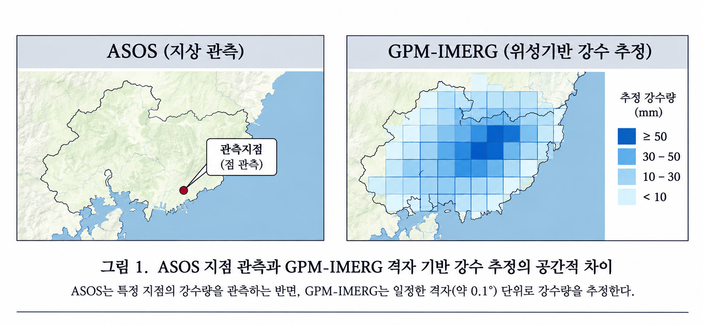

## 초록

*작성 예정 — 분석 후 실제 결과를 바탕으로 작성*

**주제어:** GPM-IMERG, ASOS, 일강수량, 지점별 편차, 강수 규모

## 1. 연구 배경 {#background}

### 1.1 여름철 강수정보의 사회적·공공적 중요성

강수량은 수자원 관리, 하천 및 배수시설 관리, 호우·침수 위험 검토 등에 활용되는 중요한 기초자료이다. 특히 우리나라의 여름철(6~8월)은 장마와 태풍, 국지성 호우 등의 영향을 받을 수 있어, 강수량이 언제, 어디에, 얼마나 내리는지 파악하는 일이 중요하다. **신뢰할 수 있는 강수정보를 확보하고 자료의 특성을 올바르게 이해하는 것은 지역 강수 분석의 기초이자 사회적·공공적 필요성을 지닌 과제**이다.

부산지방기상청에 따르면 2024년 여름철 부산·울산·경남 주요 11개 관측지점의 평균 강수량은 574.9 mm였으며, 이 중 452.9 mm(78.8%)가 장마철에 집중되었다[[1]](#ref-1). 이는 본 연구에서 비교할 부산·울산·창원 **세 지점만의 평균이 아닌 부울경 11개 지점의 평균**이다. 이 사례는 여름철 강수가 특정 시기에 집중될 수 있음을 보여주며, 강수량의 시간적·공간적 차이를 이해할 수 있는 자료의 중요성을 뒷받침한다.

### 1.2 GPM-IMERG의 특성과 활용 가치

기상청 종관기상관측(ASOS)은 관측소가 설치된 **특정 지점의 강수량**을 측정한다[[2]](#ref-2). 이와 달리 위성기반 강수자료는 넓은 지역의 강수량을 일정한 공간 격자로 제공하므로, 개별 지상 관측지점만으로는 파악하기 어려운 공간적 분포를 살펴보는 데 활용될 수 있다. NASA 또한 GPM 강수자료의 활용 분야로 수자원 관리, 재난·위험관리, 기상·기후 분석 등을 제시하고 있다[[3]](#ref-3).

본 연구에서 활용하는 GPM-IMERG는 여러 위성 관측정보를 결합하여 강수량을 추정하는 자료로, 약 0.1°(약 11 km) 격자와 30분 간격의 강수 추정값을 제공한다[[4]](#ref-4)[[5]](#ref-5). 이러한 자료는 지상 관측자료를 공간적으로 보완하는 데 활용 가치가 있다. 다만 **광범위한 지역의 강수정보를 제공한다는 장점이 곧 개별 지점에서의 강수량을 정확하게 나타낸다는 뜻은 아니므로**, 실제 활용에 앞서 자료의 특성과 한계를 검토해야 한다.

### 1.3 GPM-IMERG와 ASOS의 자료 특성 및 편차 검토의 필요성

ASOS와 GPM-IMERG는 강수량을 나타내는 **공간적 대표 범위와 산출 방식**이 다르다. ASOS는 지상 관측소에서 특정 지점의 강수량을 직접 측정하지만, GPM-IMERG는 여러 위성 관측정보를 결합한 **격자 기반 강수 추정값**을 제공한다[[2]](#ref-2)[[4]](#ref-4). 따라서 두 자료를 동일한 날짜로 대응시켜 비교하더라도 차이가 발생할 수 있으며, 이러한 차이를 모두 위성자료 자체의 오차라고 단정해서는 안 된다. 또한 IMERG Final Run은 월 단위 지상 강수 분석자료를 보정 과정에 활용하므로, 지상 관측자료와 완전히 독립적인 자료라고 보기도 어렵다[[4]](#ref-4)[[5]](#ref-5).

*그림 1. ASOS 지점 관측과 GPM-IMERG 격자 기반 강수 추정의 공간적 차이. 관측 방식과 격자의 개념을 설명하기 위한 **모식도**이며, 실제 관측소 위치나 실제 강수 분포를 나타낸 것은 아니다.*

위성기반 강수자료를 지역 강수 분석에 활용할 때에는 추정 강수량이 지상 관측값과 얼마나 차이가 나는지뿐 아니라, **어떠한 조건에서 그 차이가 나타나는지** 파악하는 것이 중요하다. 관측지점이나 강수 규모에 따라 편차의 크기와 과대·과소추정 방향이 달라진다면, 동일한 위성자료라도 분석 대상과 강수 조건에 따라 해석 시 고려할 사항이 달라질 수 있기 때문이다.

따라서 **지점별·강수 규모별 편차 특성을 검토하는 것**은 GPM-IMERG를 활용한 지역 강수 분석에서 **자료의 한계를 이해하고, 결과를 해석할 때 주의해야 할 조건을 판단하기 위한 기초자료를 마련한다는 점**에서 필요하다. 여기서 구체적으로 어떤 조건에 주의해야 하는지는 사전에 정하는 것이 아니라, 본 연구의 실제 분석을 통해 확인해야 한다.

### 1.4 선행연구 검토와 본 연구의 분석 초점

GPM-IMERG와 지상 강수자료의 비교는 이미 여러 선행연구에서 수행되었다. 이주원·이은희(2018)는 동아시아 및 남한 지역에서 IMERG를 포함한 위성기반 **일강수량 자료를 지상 관측자료와 비교**하였다[[6]](#ref-6). 백종진 외(2018)는 **2015년 국내 92개 ASOS 관측지점**을 대상으로 GPM 강수자료를 검증하고 지상 관측자료를 활용한 보정 방법을 검토하였다[[7]](#ref-7). 정임국 외(2024)는 **2021~2022년 국내 ASOS 시간강수량**을 기준으로 GPM-IMERG 및 지상 레이더 강수자료의 추정 특성을 평가하였다[[8]](#ref-8).

이러한 연구들은 위성 강수자료의 편차를 평가하는 데 중요한 근거를 제공한다. 그러나 연구별로 대상 지역, 비교 기간, 시간 단위, 자료 버전 및 분석 초점이 다르므로, 그 결과만으로 **2020~2024년 여름철 부산·울산·창원 세 지점의 일강수 편차가 어떠한지**를 바로 설명하기는 어렵다.

이에 본 연구는 **동일한 5개 여름철과 일강수량 기준을 세 관측지점에 일관되게 적용**하고, 지점별 일치도·편차 크기·과대·과소추정 경향과 **ASOS 강수 규모에 따른 지점별 편차 변화**를 연결하여 검토하고자 한다. 이는 기존 연구가 해당 분석을 수행하지 않았다고 주장하거나 최초의 연구임을 내세우려는 것이 아니라, **본 연구의 관측지점과 기간에 대한 구체적인 활용 근거를 마련하는 데** 분석 초점을 둔 것이다.

### 1.5 연구지역 및 분석기간 선정 근거

부산·울산·창원은 동일한 부산·울산·경남 권역에 속하지만, **여름철 강수량과 강한 강수의 발생 특성이 동일하지 않은 관측지점들**이다. 부산지방기상청(2021)의 공식 자료에 따르면 1991~2020년 여름철 평년 강수량은 부산 781.7 mm, 울산 623.7 mm, 창원 779.0 mm이다. 2011~2020년 평균 여름철 강수량 역시 부산 688.4 mm, 울산 522.5 mm, 창원 637.4 mm로 차이가 나타난다[[9]](#ref-9).

*그림 2. 부산·울산·창원의 여름철 강수량 비교. 자료: 부산지방기상청(2021), 표 11. **본 연구기간의 분석 결과가 아닌 과거 기후통계**이다.*

같은 자료에 따르면 2011~2020년 평균 여름철 **호우일수(일강수량 80 mm 이상인 날)**는 부산 2.2일, 울산 1.2일, 창원 1.3일로 나타났다[[9]](#ref-9). 이는 동일 권역의 세 관측지점 사이에서도 강수 규모와 강한 강수의 발생 빈도에 차이가 있음을 보여준다.

*그림 3. 부산·울산·창원의 평균 여름철 호우일수 비교(2011~2020년). 일강수량 80 mm 이상 기준. 자료: 부산지방기상청(2021), 표 17. **본 연구기간의 분석 결과가 아니다.***

이 세 지점은 기상청이 부울경 기후통계 산정에 활용하는 장기 관측지점에 포함되며[[1]](#ref-1)[[9]](#ref-9), 각각 부산(159), 울산(152), 창원(155) ASOS 관측지점에 해당한다[[2]](#ref-2). 이처럼 **같은 지역권에 있으면서도 서로 다른 강수 특성이 관찰되는 지점**에 동일한 분석 기준을 적용하는 것은 지점별 비교의 의미가 있다. 다만 과거 지상 강수량과 호우일수의 차이가 **GPM-IMERG 편차의 차이를 미리 입증하는 것은 아니며**, 본 연구는 세 지점에 한정된 비교이므로 결과를 각 도시 전체나 동남권 전체로 일반화하지 않는다.

연구기간은 장마와 호우 등 다양한 강수 조건이 나타날 수 있는 **여름철(6~8월)**로 설정하였다. 또한 특정 한 해의 사례에만 의존하지 않고 여러 여름철의 일별 관측자료를 비교하기 위해 **2020~2024년의 5개 여름철**을 대상으로 한다. 이는 연도별 기후변화를 규명하기 위한 기간이나 통계적으로 요구되는 최소 연수를 뜻하지 않으며, **지점별·강수 규모별 비교에 필요한 일별 사례를 확보하기 위한 연구범위**이다.

### 1.6 지점별·강수 규모별 편차 분석의 필요성

위성기반 강수자료의 활용 가능성을 검토하려면 먼저 지상 관측자료와 **어느 정도 일치하며 얼마나 차이가 나는지**를 확인할 필요가 있다. GPM-IMERG와 ASOS는 동일한 강수 현상을 서로 다른 방식과 공간 단위로 나타내므로, 동일 관측일의 값을 대응시켜 전반적인 일치도와 편차를 산정하는 과정이 필요하다. 이는 이후 관측지점과 강수 규모에 따른 세부적인 비교 결과를 해석하기 위한 **기초 비교 기준**을 마련한다는 의미가 있다.

그러나 이러한 전반적인 평가 결과만으로는 **각 관측지점에서 나타나는 추정 특성**을 충분히 설명하기 어렵다. 예를 들어 한 지점에서는 과대추정, 다른 지점에서는 과소추정이 나타난다면, 전체 평균 편차에서는 서로 다른 방향의 차이가 상쇄될 수 있다. 또한 동일한 권역에 속한 지점이라도 강수 특성이 다르므로 전체적인 평가 결과를 특정 지점에 그대로 적용하기에는 한계가 있다. 따라서 관측지점별 일치도와 편차의 크기를 구분하고, **과대·과소추정 경향이 지점마다 어떻게 나타나는지** 확인할 필요가 있다. 이 예시는 가능성을 설명한 것으로, 실제 추정 경향을 미리 판단한 것은 아니다.

나아가 **지점별 평균적인 편차 특성만으로도** 위성 강수자료가 모든 강수 조건에서 비슷하게 추정되는지 판단할 수는 없다. 같은 지점이라도 약한 강수와 강한 강수에서 편차의 크기와 방향이 달라질 가능성이 있으며, 지점 전체의 평균값은 그러한 차이를 가릴 수 있기 때문이다. 특히 다양한 강수 규모가 나타날 수 있는 여름철에는 **ASOS 관측 강수 규모에 따라 편차가 어떻게 변화하는지를 지점별로 검토**할 필요가 있다. 이를 통해 전반적으로 일치도가 높더라도 특정 강수 조건에서는 해석에 유의해야 하는지 등을 분석 결과에 근거해 판단할 수 있다.

결국 **전체적인 일치도·편차 산정 → 관측지점별 추정 특성 확인 → 지점별 강수 규모에 따른 편차 변화 검토**는 단순히 분석 항목을 늘리는 과정이 아니라, 앞 단계의 결과만으로 설명하기 어려운 부분을 다음 단계에서 확인하는 과정이다. 본 연구는 이러한 분석을 통해 GPM-IMERG를 **지역의 여름철 일강수량 분석에 활용할 때 어떤 지점과 강수 조건에서 편차를 주의해야 하는지 판단할 근거**를 마련하고자 한다. 구체적인 유의사항은 연구결과에 기초하여 도출하며, 특정한 편차 경향을 연구배경에서 미리 단정하지 않는다.

### 연구배경 참고문헌

**[1]** 부산지방기상청(2024.09.05), 「2024년 여름철(6~8월) 부울경 기후특성」. [원문](https://www.weather.go.kr/busan/html/news/notice_view.jsp?articleno=12662&boardId=press2&pageNo=1)

**[2]** 기상청 기상자료개방포털, 「종관기상관측(ASOS) 자료 및 지점정보」. [원문](https://data.kma.go.kr/data/grnd/selectAsosRltmList.do)

**[3]** NASA, *How is GPM data used in real-world applications?* [원문](https://gpm.nasa.gov/resources/faq/how-gpm-data-used-real-world-applications)

**[4]** NASA(2023), *IMERG V07 Technical Documentation*. [원문](https://gpm.nasa.gov/resources/documents/imerg-v07-technical-documentation)

**[5]** Google Earth Engine Data Catalog, *NASA/GPM_L3/IMERG_V07*. [원문](https://developers.google.com/earth-engine/datasets/catalog/NASA_GPM_L3_IMERG_V07)

**[6]** 이주원·이은희(2018), 「동아시아 및 남한 지역에서의 Integrated MultisatellitE Retrievals for GPM (IMERG) 일강수량의 지상관측 검증」, 『대기』, 28(3), 273–289. [원문](https://doi.org/10.14191/Atmos.2018.28.3.273)

**[7]** 백종진 외(2018), 「GPM 위성 강우자료의 검증과 지상관측 자료를 통한 강우 보정 기법」, 『한국수자원학회논문집』, 51(2). [원문](https://doi.org/10.3741/JKWRA.2018.51.2.131)

**[8]** 정임국 외(2024), *Accuracy Assessment of Precipitation Products from GPM IMERG and CAPPI Ground Radar over South Korea*, 『대한원격탐사학회지』, 40(3), 269–274. [원문](https://doi.org/10.7780/kjrs.2024.40.3.3)

**[9]** 부산지방기상청(2021.06.09), 「신평년(1991~2020년) 대비 최근 10년(2011~2020년) 여름철 부울경 기후특성」, 표 11·17. [보도자료 및 PDF](https://www.kma.go.kr/busan/html/news/notice_view.jsp?articleno=11651&boardId=press2&pageNo=1)

## 2. 연구 질문 {#question}

*작성 예정*

## 3. 연구 목적 {#objectives}

*작성 예정*

## 4. 재료 {#materials}

*작성 예정*

## 5. 방법 {#method}

*작성 예정*

## 6. 결과 {#results}

*작성 예정*

## 7. 토의 {#discussion}

*작성 예정*

## 8. 결론 {#conclusion}

*작성 예정*

---

### 부록 · 재현성 및 연구 기여 {#reproduce}

*작성 예정*

[섹션별 작성 지침]({{ site.github.repository_url }}/blob/main/05_보고서양식/섹션별_작성지침.md)

